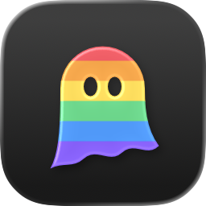
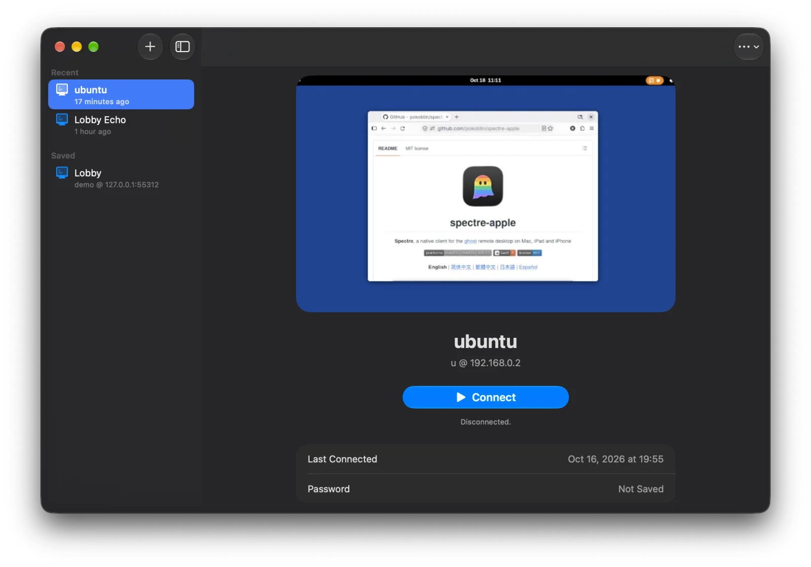

<div align="center">



# spectre-apple

**Spectre**, un cliente nativo del escritorio remoto [ghost](https://github.com/jsaiko/ghost) para Mac, iPad e iPhone

[](#requisitos)
[](https://www.swift.org)
[](LICENSE)

[English](README.md) | [简体中文](README.zh-Hans.md) | [繁體中文](README.zh-Hant.md) | [日本語](README.ja.md) | **Español**

</div>


ghost es un sistema de escritorio remoto de código abierto: un host (wraith) transmite un escritorio Linux mediante el protocolo GDP, y un cliente lo muestra y devuelve la entrada. spectre-apple es ese cliente para los dispositivos de Apple, escrito en Swift con SwiftUI, Metal y VideoToolbox sobre la biblioteca de protocolo de ghost, libgdp.

Es un cliente independiente, de terceros, y no forma parte del proyecto ghost (consulta los [agradecimientos](#agradecimientos)).

## Funciones

**Conexión**

- Inicia sesión con tu nombre de usuario y contraseña, responde a las demás preguntas, como un código de un solo uso, y elige un dispositivo y una sesión de escritorio, o toma el control de una que ya está en marcha.
- Confianza en el primer uso: confirmas una vez la huella del certificado del servidor y se recuerda; **Servidores de confianza…** las muestra y te permite olvidarlas.
- Guarda la contraseña con el servidor para Conectar con un toque, si quieres en el llavero.
- Las conexiones perdidas (al cambiar de Wi-Fi, al dormirse el equipo o al suspender iOS la app) se vuelven a conectar solas.
- Desconectar (la sesión de escritorio sigue en marcha) o cerrar sesión (la termina).

**Imagen y sonido**

- H.264, HEVC y AV1, decodificados por hardware y mostrados con Metal sin copiar fotogramas. En los dispositivos que decodifican AV1 por hardware (Apple M3, A17 Pro y posteriores) se pide AV1 primero, y se usa si la GPU del host puede codificarlo; si no, HEVC.
- Refinamiento sin pérdidas: cuando una parte de la pantalla deja de cambiar, el host la vuelve a enviar sin pérdidas y se muestra exacta píxel a píxel sobre el vídeo, así que el texto y las líneas se ven nítidos. Activado por defecto; **Más › Refinamiento sin pérdidas** lo desactiva para ahorrarle trabajo al host.
- PyroWave en una red por cable: cuando el host está en la misma red por cable a 1 Gbit/s o más, Spectre pide primero PyroWave, un códec wavelet solo intra que se ve casi sin pérdidas a unos cientos de Mbit/s y se decodifica en la GPU en alrededor de un milisegundo. Por Wi-Fi, un enlace más lento u otra red se usan los códecs de siempre. Necesita un host con PyroWave activado y una GPU lo bastante rápida para codificarlo: una GPU integrada pequeña puede no dar abasto a resoluciones altas (un Intel N100 llega a unos 25 fps a 2560×1496). **Más › PyroWave en redes por cable** lo desactiva e indica si se está usando o por qué no.
- El escritorio remoto se ajusta al tamaño de la ventana o de la pantalla, o funciona a la resolución Retina completa.
- En el Mac, la pantalla completa oculta la barra de herramientas y la barra de menús hasta que el puntero llega al borde superior.
- El sonido del escritorio remoto, con un búfer de fluctuación y un botón para silenciarlo.

**Entrada**

- Las teclas se envían por su posición física, así que la distribución de teclado remota decide qué escriben.
- Ratón con todos los botones, desplazamiento suave y un modo capturado con movimiento relativo para juegos y 3D; el cursor remoto se dibuja localmente.
- En iPad: teclados, trackpads y ratones físicos, y los dedos en modo de toque directo o de trackpad.
- En iPhone y iPad: el teclado en pantalla, con una barra de teclas para las flechas, Esc, Tab, modificadores que quedan pulsados y combinaciones del sistema como Super+Tab.
- Hasta cuatro mandos.

**Portapapeles y archivos**

- Portapapeles de texto en ambos sentidos, desactivado hasta que lo actives.
- Copiar y pegar archivos y carpetas en ambos sentidos en el Mac: copia en el Finder y pega en el escritorio remoto, o copia allí y pega en el Finder (hasta 100 MB cada vez; las copias más grandes se ofrecen para descargar).
- En iPad, los archivos y carpetas copiados en la app Archivos también se pegan en el escritorio remoto.
- Envía archivos al host: suéltalos sobre la imagen o usa **Enviar archivos…**. Se guardan en la carpeta de descargas del usuario del host, nunca encima de un archivo existente, y Spectre dice en qué carpeta.
- Descarga archivos y carpetas copiados en el host: a Descargas en el Mac, y a la carpeta de Spectre en la app Archivos en iPad y iPhone.
- Comparte una carpeta con el host, de solo lectura: aparece en el gestor de archivos del host con el nombre del dispositivo.
- Progreso, cancelación y resultados en una lista de transferencias. Hace falta un host con transferencia de archivos; consulta [Requisitos](#requisitos).

**En el Mac**

- Una ventana de inicio con tus hosts y la última imagen de cada uno, y una ventana por sesión, así que puedes tener varias a la vez.
- Una barra de herramientas con el menú **Archivos**, la lista de transferencias, el portapapeles compartido, la captura del ratón y el silencio, con el tiempo de ida y vuelta y los fotogramas por segundo en el subtítulo.
- Un menú **Session** para los archivos, las carpetas compartidas, la captura del ratón, el portapapeles y las combinaciones de teclas que macOS se queda. Sin atajos nuevos, así que todas las teclas llegan al escritorio remoto.

**En iPad y iPhone**

- El escritorio remoto ocupa toda la pantalla; los controles flotan encima en Liquid Glass y se recogen en dos botones en las esquinas.
- Un panel de texto: escribe con los métodos de entrada del sistema, el dictado o pegando, y envíalo todo de una vez al cursor del host.
- Entrada por voz: mantén pulsada la tecla del micrófono y habla; lo que digas se transcribe en el dispositivo y se escribe en el host.
- Pellizca para ampliar la imagen, o usa **Llenar la pantalla**; ampliada, la imagen sigue al puntero.
- Avisos de región: vigila una parte de la pantalla, como un terminal, y recibe un aviso cuando deja de cambiar o empieza a cambiar.

**Idiomas:** inglés, chino simplificado, chino tradicional, japonés y español.

**Pendiente:** enviar tu micrófono al host (escrito, desactivado por ahora), y comprobar en iOS los certificados emitidos por una autoridad de certificación.

## Capturas de pantalla

| La ventana de inicio en el Mac | Una sesión en iPad |
|---|---|
|  |  |

## Requisitos

- Un Mac con Apple silicon y macOS 27, o un iPhone o iPad con iOS o iPadOS 27
- Un host ghost (ghostd y wraith); consulta el proyecto [ghost](https://github.com/jsaiko/ghost) para montar uno
- Para transferir archivos, un ghost reciente (el `main` del proyecto original desde octubre de 2026). Pegar archivos copiados aquí y compartir carpetas requiere además un wraith compilado con libfuse3 3.12 o posterior (`apt install libfuse3-dev` antes de compilar) en un host con `/dev/fuse` y `fusermount3`: el host monta lo que Spectre ofrece. Sin ello, enviar y descargar siguen funcionando.
- Para PyroWave, un wraith compilado con libpyrowave (`packaging/build-pyrowave.sh` de ghost, que fija la revisión que ambos extremos deben compartir) y `pyrowave = true` en `[encode.codecs]` de `/etc/ghost/wraith.toml`.

## Instalación

Descarga el `.dmg` notarizado para Mac desde [GitHub Releases](https://github.com/pokoblin/spectre-apple/releases/latest) y arrastra Spectre a Aplicaciones. Para iPhone y iPad, compílalo desde el código fuente.

## Uso

Añade un servidor con **+**: su dirección (`host` o `host:port`; el puerto por omisión es 4442), tu nombre de usuario y, si quieres, tu contraseña. Luego **Conectar** y elige un escritorio. En la primera conexión, confirma la huella del certificado del servidor.

En el Mac, cada sesión se abre en su propia ventana; al cerrarla se desconecta y el escritorio sigue abierto en el host. En iPad y iPhone la sesión cubre la pantalla de inicio.

**Archivos.** En el Mac, todo está en el menú **Archivos** de la barra de herramientas y en el menú **Session**; en iPad y iPhone, en **Más › Archivos**.

- **Copiar y pegar** (Mac, con el portapapeles compartido): los archivos y carpetas copiados en el Finder se pegan en el escritorio remoto, que los lee del Mac mientras se pegan, así que deja Spectre abierto hasta que termine; la lista de transferencias lo muestra y permite detenerlo. Los archivos y carpetas copiados en el host pasan al portapapeles del Mac si suman 100 MB o menos, y **Pegar** en el Finder pega los archivos.
- **Copiar y pegar** (iPad, con el portapapeles compartido): los archivos y carpetas copiados en la app Archivos se pegan en el escritorio remoto. iPadOS pregunta cada vez antes de que Spectre pueda leerlos, salvo que pongas **Ajustes › Apps › Spectre › Pegar desde otras apps** en **Permitir** (Spectre lo sugiere una vez). iPadOS da a las apps una copia, no los originales: Spectre la guarda hasta que el host la tiene, así que una copia grande lleva un momento y algo de espacio. Deja Spectre delante mientras el host pega.
- **Enviar archivos…**, o suelta archivos sobre la imagen: el host los guarda en la carpeta de descargas de su usuario (`~/Downloads`, o `[files] directory` en wraith.toml), como «nombre (1).ext» si el nombre ya existe. Las carpetas van con copiar y pegar.
- **Descargar**: cuando el usuario del host copia archivos o carpetas, Spectre ofrece descargarlos, a Descargas en el Mac y a la carpeta de Spectre en la app Archivos en iPad y iPhone.
- **Compartir carpeta…**: el host ve la carpeta, de solo lectura y sin archivos ocultos, hasta que dejes de compartirla (**Dejar de compartir**, en los mismos menús, o la lista de transferencias) o cierres Spectre. Se vuelve a compartir cada vez que la sesión se reconecta, y **Volver a compartir** recupera una que dejaste de compartir. En iPad y iPhone, elige una carpeta en la app Archivos: del dispositivo, de iCloud Drive o de otra app.

**Teclado en el Mac.** Cmd se envía como Super, así que copiar y pegar en el escritorio remoto siguen siendo Ctrl+C y Ctrl+V. Solo estos atajos se quedan en tu Mac:

| Atajo | Acción |
|---|---|
| Ctrl+Cmd+G | Capturar o liberar el ratón |
| Ctrl+Cmd+F | Pantalla completa |
| Cmd+Q | Salir |

**Toques en iPad y iPhone.** **Más › Modo de entrada** cambia entre:

- **Trackpad** (predeterminado): mueve el cursor con un dedo y toca para hacer clic.
- **Táctil**: el puntero va donde tocas. Toca para hacer clic, mantén pulsado para el clic derecho, arrastra con un dedo, desplázate con dos y toca con dos o tres dedos para el clic derecho o central.

## Compilar desde el código fuente

Necesitas Xcode 27 con el entorno de ejecución del simulador de iOS 27, [XcodeGen](https://github.com/yonaskolb/XcodeGen), `cmake` 3.25 o posterior y `ninja` (`brew install cmake ninja`), y [vcpkg](https://github.com/microsoft/vcpkg), a ser posible en el commit que usa la CI del proyecto original:

```bash
git clone https://github.com/microsoft/vcpkg ~/src/vcpkg
```

```bash
git -C ~/src/vcpkg checkout 07f4812200df3d3c931c0c8a6081d3b21fe2bf9f
```

```bash
~/src/vcpkg/bootstrap-vcpkg.sh -disableMetrics
```

Si tienes vcpkg en otro sitio, define `VCPKG_ROOT`.

1. Clona el repositorio con el submódulo de ghost, que sigue el `main` del fork [pokoblin/ghost](https://github.com/pokoblin/ghost) (el del proyecto original). En un clon existente, ejecuta `git submodule sync && git submodule update --init`.

   ```bash
   git clone --recurse-submodules https://github.com/pokoblin/spectre-apple.git
   ```

2. Compila `GDPCore.xcframework` (libgdp, sus dependencias y un puente en C) en `Packages/GDPKit/Artifacts/`. La primera vez tarda unos minutos; indica `macos`, `ios` o `ios-simulator` para compilar solo esos slices.

   ```bash
   scripts/build-gdpcore.sh
   ```

   Después compila `PyroWave.xcframework` (el port a Metal del códec PyroWave, del submódulo `third_party/pyrowave`) en `Packages/SpectreKit/Artifacts/`; tarda unos segundos.

   ```bash
   scripts/build-pyrowave.sh
   ```

3. Genera el proyecto de Xcode, abre `Spectre.xcodeproj` y ejecuta el esquema `Spectre`:

   ```bash
   xcodegen generate
   ```

   O compila la app para Mac desde la línea de comandos y cópiala a Aplicaciones:

   ```bash
   xcodebuild -project Spectre.xcodeproj -scheme Spectre -destination 'platform=macOS,arch=arm64' -configuration Release -derivedDataPath build/DerivedData build
   ```

   ```bash
   ditto build/DerivedData/Build/Products/Release/Spectre.app /Applications/Spectre.app
   ```

Para un iPhone o iPad, elige tu equipo de desarrollo para el target en Xcode.

## Desarrollo

### Pruebas

```bash
swift test --package-path Packages/GDPKit
```

```bash
swift test --package-path Packages/SpectreKit
```

Los dos paquetes incluyen un host y un lobby de prueba dentro del proceso, así que las pruebas de extremo a extremo usan QUIC real por la interfaz de bucle local. Para el simulador de iPad, ejecuta `xcodebuild test` en cada paquete con `-destination 'platform=iOS Simulator,name=iPad Pro 13-inch (M5),OS=27.0'`.

### Sin servidor

Estas opciones se saltan el inicio de sesión y reproducen un flujo de prueba generado a 1080p60, con las estadísticas en pantalla y en stdout:

- `--source loopback` (la predeterminada): un host de prueba dentro de la app, por una sesión GDP real en 127.0.0.1
- `--source direct`: directamente al decodificador, sin red
- `--connect HOST:PORT --token TOKEN --fingerprint SHA256`: un wraith iniciado con un token estático
- `--bench N`: mide durante N segundos, imprime los resultados y sale

```bash
build/DerivedData/Build/Products/Release/Spectre.app/Contents/MacOS/Spectre --bench 60 --codec h265
```

Además: `--codec h264|h265|av1|pyrowave` (AV1 reproduce un stream incluido, donde se decodifica por hardware; el de PyroWave lo codifica en el momento su versión para Metal, a unos 250 Mbit/s), `--mode onArrival|displayLink`, `--in-flight N`, `--screen N`, `--rate HZ`, `--min-present-ms MS`, `--host-clipboard TEXT`.

Para probar la transferencia de archivos con el host de loopback: `--send-file PATH` envía un archivo al empezar la sesión, `--host-file PATH` hace que el usuario del host de prueba copie uno, también una carpeta (ambas se pueden repetir), `--download-copied` descarga cada copia y `--download-dir DIR` guarda las descargas en `DIR`. `--host-fetch-copied` hace que el host de prueba lea cada archivo copiado aquí, como haría un pegado, y `--share-folder DIR` comparte una carpeta al empezar la sesión; el host de prueba imprime lo que recibe y lista cada carpeta compartida.

En el simulador de iOS:

```bash
xcodebuild -project Spectre.xcodeproj -scheme Spectre -destination 'platform=iOS Simulator,name=iPad Pro 13-inch (M5),OS=27.0' -configuration Release -derivedDataPath build/DerivedData build
```

```bash
xcrun simctl install booted build/DerivedData/Build/Products/Release-iphonesimulator/Spectre.app
```

```bash
xcrun simctl launch --console-pty booted org.ghost.spectre.apple --source loopback
```

El simulador decodifica por software, así que sus tiempos no se pueden comparar con los de un dispositivo.

### Estructura del proyecto

| Ruta | Contenido |
|---|---|
| `project.yml` | El proyecto de XcodeGen: un único target de app multiplataforma |
| `App/` | La app: puntos de entrada, la pantalla de inicio, la interfaz de la sesión, la transferencia de archivos, los controles de iPad y iPhone, el icono |
| `Packages/GDPKit/` | El puente en C hacia libgdp y su capa en Swift |
| `Packages/SpectreKit/` | La sesión, la decodificación, la presentación con Metal, la entrada, el portapapeles, la transferencia de archivos, el inicio de sesión |
| `scripts/` | Compilan las dependencias y los xcframeworks |
| `third_party/ghost/` | ghost como submódulo (el `main` del fork pokoblin/ghost, que sigue al original); solo se compila libgdp |
| `third_party/pyrowave/` | PyroWave como submódulo; solo se compila su port a Metal (`metal/`) |

## Cómo contribuir

Las incidencias y las pull requests son bienvenidas; para cambios grandes, abre antes una incidencia.

- Escribe el código cliente a partir de la especificación de GDP (`third_party/ghost/docs/spec/gdp-spec.md`) y de estándares públicos. La mayor parte del proyecto ghost original es GPL-3.0, así que no copies ni adaptes código de él, incluido su cliente spectre; solo `libgdp/` y la especificación son MIT.
- Ejecuta las pruebas de los dos paquetes antes de enviar un cambio.
- Los textos nuevos de la interfaz necesitan traducción a todos los idiomas; `scripts/sync-strings.sh` actualiza los String Catalogs.

## Agradecimientos

spectre-apple está inspirado en [ghost](https://github.com/jsaiko/ghost), de [Joseph Saiko](https://saiko.dev): el protocolo GDP, el host wraith y el cliente spectre para Linux. Usa la biblioteca libgdp de ghost, sigue su especificación y sus documentos de diseño publicados, y toma el nombre Spectre del cliente original. Muchas gracias al autor por publicar ghost como código abierto y por liberar libgdp y la especificación bajo la licencia MIT; sin ello este proyecto no existiría.

## Licencia

[MIT](LICENSE).

- En el proyecto ghost original, `libgdp/` y la especificación son MIT, y todo lo demás es GPL-3.0-only. Este proyecto solo compila `libgdp/`, y nada de su código está copiado ni adaptado de las partes GPL.
- La app enlaza estáticamente ngtcp2, OpenSSL, Protocol Buffers, Abseil, zstd y PyroWave (MIT, Apache-2.0, BSD-3-Clause); sus avisos de licencia están en [THIRD_PARTY_NOTICES.md](THIRD_PARTY_NOTICES.md).
