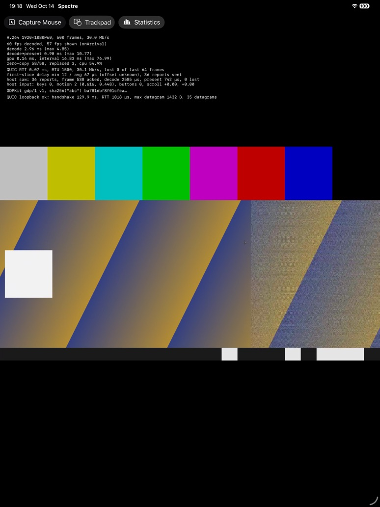

<div align="center">


# spectre-apple

**Spectre**：[ghost](https://github.com/jsaiko/ghost) リモートデスクトップの Mac、iPad、iPhone 向けネイティブクライアント

[](#動作環境)
[](https://www.swift.org)
[](LICENSE)

[English](README.md) | [简体中文](README.zh-Hans.md) | [繁體中文](README.zh-Hant.md) | **日本語** | [Español](README.es.md)

</div>


ghost はオープンソースのリモートデスクトップシステムです。ホスト（wraith）が GDP プロトコルで Linux のデスクトップを配信し、クライアントがそれを表示して入力を送り返します。spectre-apple はこのクライアントを Apple デバイスにネイティブアプリとして提供します。Swift、SwiftUI、Metal、VideoToolbox で書かれており、ghost 自身のプロトコルライブラリ libgdp の上に構築されています。

spectre-apple は ghost に触発された独立したサードパーティ製クライアントであり、ghost プロジェクトの一部ではありません。詳しくは[謝辞](#謝辞)をご覧ください。

## 機能

**サインイン**

- ユーザ名とパスワードで ghost サーバーにサインインします。ワンタイムコードなど、サーバーからの追加の質問は順に表示されます。その後、デバイスとデスクトップのセッションを選ぶか、実行中のセッションを引き継ぎます。
- 初回信頼（TOFU）：最初の接続時にサーバーの証明書のフィンガープリントを確認し、以後はそれを記憶します。ログイン画面の **信頼済みのサーバー…** で、記憶したフィンガープリントを一覧・削除できます。
- **保存する** にチェックを入れると、ログイン情報がこのデバイスのキーチェーンだけに保存され、最近のログインからワンタップで接続できます。
- 接続が切れても（Wi-Fi の切り替え、Mac のスリープ、iOS によるアプリの一時停止など）自動的に再接続します。

**映像と音声**

- H.264 と HEVC を VideoToolbox でハードウェアデコードし、フレームをコピーせずに Metal で表示します。フレームの損失と遅延の統計はホストに報告されます。
- リモートデスクトップのサイズはウインドウ（iPad と iPhone では画面）に合わせて変わります。ツールバーの**解像度**メニューでこれをオフにしたり、Retina のフル解像度を要求したりできます。
- リモートデスクトップの音声。パケット損失を補うジッタバッファ付きで、消音もできます。
- オンにしている間、マイクの音声をリモートデスクトップに送ります。

**入力**

- キーは物理的な位置で送られるため、入力される文字はリモート側のキーボード配列で決まります。
- マウスはすべてのボタンとスムーズスクロールに対応し、ゲームや 3D ビュー向けに相対移動を送るキャプチャモードもあります。リモートのカーソルはローカルで描画します。
- iPad：ハードウェアキーボード、トラックパッド、マウスに対応し、指での操作は「ダイレクトタッチ」と「トラックパッド」の 2 つのモードから選べます。
- iPhone と iPad：オンスクリーンキーボードでリモートデスクトップに入力でき、Esc、Tab、修飾キー、矢印キー、ファンクションキーを並べたキーバーが付きます。

**共有**

- テキストのクリップボードを双方向に同期します。初期設定ではオフです。
- 最大 4 台のゲームコントローラを、標準のゲームパッドとして転送します。

**そのほか**

- 切断（リモートのセッションは実行を続けます）とログアウト（セッションを終了します）。
- インターフェイスは英語、簡体字中国語、繁体字中国語、日本語、スペイン語に対応し、システムの言語に従います。

### ロードマップ

未実装：

- 可逆の高画質化レイヤー（refine）、AV1 と PyroWave コーデック
- マイクのエコーキャンセル
- iOS での認証局発行の証明書の検証（現在はほかの証明書と同じく初回信頼で扱います）

## スクリーンショット

| Mac でのサインイン | iPad のトラックパッドモード |
|---|---|
|  |  |

## 動作環境

- Apple シリコン搭載で macOS 27 の Mac、または iOS / iPadOS 27 の iPhone・iPad（arm64 のみ）
- 接続先の ghost ホスト（ghostd と wraith）。構築方法は [ghost](https://github.com/jsaiko/ghost) プロジェクトをご覧ください

## はじめに

Mac 版は [GitHub Releases](https://github.com/pokoblin/spectre-apple/releases/latest) にあります。`.dmg` をダウンロードして開き、Spectre を「アプリケーション」フォルダにドラッグしてください。Developer ID で署名され、Apple の公証を受けています。

iPhone と iPad で使う場合や、開発に参加する場合は、以下の手順でソースからビルドします。

### 必要なツール

- Xcode 27（iOS 27 シミュレータのランタイムを含む）
- [XcodeGen](https://github.com/yonaskolb/XcodeGen)
- `cmake`（3.25 以降）と `ninja`：`brew install cmake ninja`
- [vcpkg](https://github.com/microsoft/vcpkg)。上流の CI が使っているコミットに固定するのがおすすめです：

```bash
git clone https://github.com/microsoft/vcpkg ~/src/vcpkg
```

```bash
git -C ~/src/vcpkg checkout 07f4812200df3d3c931c0c8a6081d3b21fe2bf9f
```

```bash
~/src/vcpkg/bootstrap-vcpkg.sh -disableMetrics
```

vcpkg を `~/src/vcpkg` 以外に置く場合は `VCPKG_ROOT` を設定してください。

### ビルド

1. 上流の ghost サブモジュールごとリポジトリをクローンします（既存のクローンでは `git submodule update --init` を実行します）：

   ```bash
   git clone --recurse-submodules https://github.com/pokoblin/spectre-apple.git
   ```

2. `GDPCore.xcframework` をビルドします。libgdp とその依存ライブラリ、薄い C ブリッジをまとめたもので、`Packages/GDPKit/Artifacts/` に出力され、リポジトリにはコミットしません。初回のビルドには数分かかりますが、以降は vcpkg のバイナリキャッシュが使われます。ログは `build/logs/` に出力されます。

   ```bash
   scripts/build-gdpcore.sh
   ```

   既定では `macos`、`ios`、`ios-simulator` の 3 つのスライスをビルドします。一部だけをビルドするには名前を指定します（例：`scripts/build-gdpcore.sh macos`）。

3. Xcode プロジェクトを生成し、`Spectre.xcodeproj` を開いて `Spectre` スキームを実行します：

   ```bash
   xcodegen generate
   ```

   Mac アプリはコマンドラインでもビルドできます：

   ```bash
   xcodebuild -project Spectre.xcodeproj -scheme Spectre -destination 'platform=macOS,arch=arm64' -configuration Release -derivedDataPath build/DerivedData build
   ```

4. Mac アプリを常用する場合は「アプリケーション」フォルダにコピーします：

   ```bash
   ditto build/DerivedData/Build/Products/Release/Spectre.app /Applications/Spectre.app
   ```

iPhone や iPad で実行するには、Xcode でターゲットの開発チームを選んでください。

## 使い方

Spectre を起動するとログイン画面が開きます。サーバー（`host` または `host:port`。ポートの既定値は 4442）、ユーザ名、パスワードを入力し、デスクトップを選びます。最初の接続時には、サーバーの証明書のフィンガープリントの確認を求められます。ワンタイムコードなど、サーバーがほかの情報を求める場合はそれぞれ個別に尋ねられます。パスワードを空欄にすると、すべての質問がこの方法で尋ねられます。

### キーボードとマウス

Cmd は Super キー（Windows キー）として送られるため、リモートデスクトップでのコピー＆ペーストは Ctrl+C と Ctrl+V のままです。Mac 側に残るショートカットは次の 3 つだけです：

| ショートカット | 動作 |
|---|---|
| Ctrl+Cmd+G | マウスのキャプチャと解除（ツールバーの「マウスをキャプチャ」ボタンでも可） |
| Ctrl+Cmd+F | フルスクリーン |
| Cmd+Q | 終了 |

### iPad と iPhone でのタッチ操作

ツールバーで 2 つのモードを切り替えます：

- **タッチ**：触れた位置にポインタが移動します。タップでクリック、長押しで右クリック、1 本指のドラッグでドラッグ、2 本指のドラッグでスクロール、2 本指または 3 本指のタップで右クリックまたは中クリックです。
- **トラックパッド**（デフォルト）：画面をトラックパッドとして使います。1 本指でカーソルを動かし、タップでクリックします。

### 音声とマイク

ホストが音声を送ってくると再生されます（wraith はセッションの音声を取得できる場合に送ります）。ツールバーの **消音** はこのデバイスだけを消音し、設定は記憶されます。

ツールバーの **マイク** は、マイクの音声をリモートデスクトップに送り、セッションの既定の録音デバイスにします。セッションの開始時は毎回オフで、初回はシステムが許可を求めます。エコーキャンセルはまだないので、ヘッドホンを使ってください。使わないとリモートデスクトップに自分自身の音声が聞こえてしまいます。

## 開発

### テスト

```bash
swift test --package-path Packages/GDPKit
```

```bash
swift test --package-path Packages/SpectreKit
```

どちらのパッケージにもプロセス内のテストホストとテスト用 lobby があり、エンドツーエンドのテストはループバック上の実際の QUIC 接続で行います。SpectreKit のテストでは、H.264 と HEVC のカラーバーをデコードして Metal で描画することも確認します。iPad シミュレータで実行するには：

```bash
(cd Packages/GDPKit && xcodebuild test -scheme GDPKit -destination 'platform=iOS Simulator,name=iPad Pro 13-inch (M5),OS=27.0' -derivedDataPath ../../build/DerivedData-GDPKit)
```

```bash
(cd Packages/SpectreKit && xcodebuild test -scheme SpectreKit -destination 'platform=iOS Simulator,name=iPad Pro 13-inch (M5),OS=27.0' -derivedDataPath ../../build/DerivedData-SpectreKit)
```

### サーバーなしで動かす

次のいずれかのオプションを付けて起動すると、Spectre はログインを飛ばしてすぐに再生を始めます。まず VideoToolbox で 10 秒間の 1080p60 テストストリームをエンコードし（約 3 秒）、それをループ再生します。デコード、表示、セッションの統計は左上に表示され、毎秒 stdout にも出力されます。ツールバーでソース、コーデック、表示のペースを切り替えられます。ソースは 3 種類です：

- **Loopback**（既定）：アプリ内のテストホストが、実際の GDP セッション（127.0.0.1 上の QUIC）でストリームを送ります。音声のテストのため、毎秒ビープ音も鳴らします。
- **Direct**：ストリームをネットワークを通さず直接デコーダに渡します。
- **Remote**：静的トークンで起動した wraith（仕様 §6.11）：

```bash
build/DerivedData/Build/Products/Release/Spectre.app/Contents/MacOS/Spectre --connect HOST:PORT --token TOKEN --fingerprint SHA256
```

ベンチマークモードは、2 秒のウォームアップの後 N 秒間計測し、統計を出力して終了します：

```bash
build/DerivedData/Build/Products/Release/Spectre.app/Contents/MacOS/Spectre --bench 60 --codec h265
```

そのほかのオプション：`--source loopback|direct`、`--codec h264|h265`、`--mode onArrival|displayLink`、`--in-flight <N、0 で無制限>`、`--screen <画面の番号>`、`--rate <display link の Hz>`、`--min-present-ms <ms>`、`--host-clipboard <テキスト>`（loopback ホストのクリップボードの初期内容）。

### iOS と iPadOS のシミュレータ

```bash
xcodebuild -project Spectre.xcodeproj -scheme Spectre -destination 'platform=iOS Simulator,name=iPad Pro 13-inch (M5),OS=27.0' -configuration Release -derivedDataPath build/DerivedData build
```

```bash
xcrun simctl install booted build/DerivedData/Build/Products/Release-iphonesimulator/Spectre.app
```

```bash
xcrun simctl launch --console-pty booted org.ghost.spectre.apple --source loopback
```

iOS では、ルートビューコントローラがポインタをロックできるように、アプリは UIKit の app delegate から起動します（[docs/input.md](docs/input.md) を参照）。この変更より前のビルドをインストールしたことがある場合は、一度アンインストールしてください（`xcrun simctl uninstall booted org.ghost.spectre.apple`）。そうしないとシステムが古いウインドウを復元し、画面が黒いままになります。

シミュレータでは VideoToolbox がソフトウェアでデコードし、`presentedTime` もないため、そこで計測した時間は実機や Mac とは比較できません。

### ディレクトリ構成

| パス | 内容 |
|---|---|
| `project.yml` | XcodeGen のプロジェクト。macOS と iOS 共通のアプリターゲットが 1 つ |
| `App/` | アプリ本体：プラットフォームごとのエントリポイント、ログインとセッションの UI、アイコン |
| `Packages/GDPKit/` | libgdp への C ブリッジ（`Native/`）と、その Swift ラッパー：セッション、lobby、テストホスト |
| `Packages/SpectreKit/` | 共通コード：セッション、VideoToolbox でのデコード、Metal での表示、入力、ログインの流れ |
| `scripts/` | 依存ライブラリと xcframework をビルドするスクリプト |
| `docs/` | 設計メモと計測記録（簡体字中国語） |
| `experiments/` | 一度きりの実験（Swift/C++ 相互運用の検証など）。アプリには含まれません |
| `third_party/ghost/` | 上流の ghost（git サブモジュール、読み取り専用） |

### 設計メモ

[`docs/`](docs/) 以下のメモには、各部分の仕組み、計測の結果、途中で遭遇した問題を記録しています。メモは簡体字中国語で書かれています。

- [prototype-findings.md](docs/prototype-findings.md)：プロトタイプでの 3 つの技術的リスクと、それぞれの結論（Swift からの libgdp の呼び出し、ゼロコピーの表示、iOS 向けのクロスコンパイル）
- [session-client.md](docs/session-client.md)：セッション層。仕様の §6〜§11 と照合
- [login.md](docs/login.md)：lobby へのログインと証明書の信頼
- [saved-logins.md](docs/saved-logins.md)：キーチェーンに保存したパスワード、ワンタップでのサインイン
- [reconnect.md](docs/reconnect.md)：切れたセッションの再接続、ログインの再実行、iOS のバックグラウンド
- [keep-alive.md](docs/keep-alive.md)：QUIC のキープアライブと、切断の検出にかかる時間
- [resolution.md](docs/resolution.md)：リモートデスクトップの解像度をウインドウに合わせる
- [input.md](docs/input.md)：キーボード、マウス、カーソル、タッチ
- [keyboard.md](docs/keyboard.md)：iOS のオンスクリーンキーボード、文字からキーへの変換、キーバー
- [audio.md](docs/audio.md)：音声、ジッタバッファ、Opus のデコード、マイク
- [clipboard.md](docs/clipboard.md)：Mac と iPad のクリップボード、エコーの抑制、ペーストの確認
- [gamepad.md](docs/gamepad.md)：ゲームコントローラ、ボタンの割り当て、Home ボタン
- [localization.md](docs/localization.md)：インターフェイスの言語、用語集、文字列の追加方法
- [app-icon.md](docs/app-icon.md)：アプリアイコンのデザインと変更方法

## コントリビュート

Issue やプルリクエストを歓迎します。大きな変更の場合は、先に Issue を立ててください。いくつか注意点があります：

- クライアントのコードは、GDP の仕様（`third_party/ghost/docs/spec/gdp-spec.md`）と公開されている標準規格をもとに書いています。上流の ghost の大部分は GPL-3.0 なので、そこからコードをコピーしたり移植したりしないでください（上流の spectre クライアントも含みます）。MIT なのは `libgdp/` と仕様だけです。
- 変更を送る前に両方のパッケージのテストを実行し、動作が変わる場合は `docs/` 以下の該当するメモも更新してください。
- 新しい UI の文言には、String Catalog ですべての言語の翻訳が必要です。[docs/localization.md](docs/localization.md) をご覧ください。

## 謝辞

spectre-apple は、[Joseph Saiko](https://saiko.dev) さんの [ghost](https://github.com/jsaiko/ghost) に触発されたプロジェクトです。ghost は、GDP プロトコル、ホストの wraith、Linux 向けクライアントの spectre からなる、完結したリモートデスクトップシステムです。本プロジェクトは ghost のプロトコルライブラリ libgdp を使い、ghost が公開しているプロトコル仕様と設計ドキュメントをもとに書かれており、Spectre という名前も上流のクライアントから借りています。ghost をオープンソースで公開し、libgdp とプロトコル仕様を MIT ライセンスで提供してくださった作者に深く感謝します。それがなければ、このプロジェクトは存在しませんでした。

spectre-apple は独立したサードパーティ製のクライアントであり、ghost プロジェクトの一部ではありません。

## ライセンス

[MIT](LICENSE)。

- 上流の ghost では、`libgdp/` とプロトコル仕様が MIT、それ以外（上流自身の spectre クライアントを含む）は GPL-3.0-only です。本プロジェクトがビルドするのは `libgdp/` だけで、クライアントのコードは仕様と公開されている標準規格をもとに独自に書いており、GPL の部分からコードをコピーしたり移植したりはしていません。
- アプリは ngtcp2、OpenSSL、Protocol Buffers、Abseil、zstd を静的にリンクしています。いずれも寛容なライセンス（MIT、Apache-2.0、BSD-3-Clause）です。バイナリを配布する場合は、それらのライセンス表示を同梱する必要があります。[THIRD_PARTY_NOTICES.md](THIRD_PARTY_NOTICES.md) をご覧ください。
