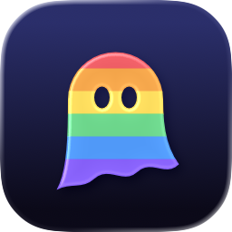
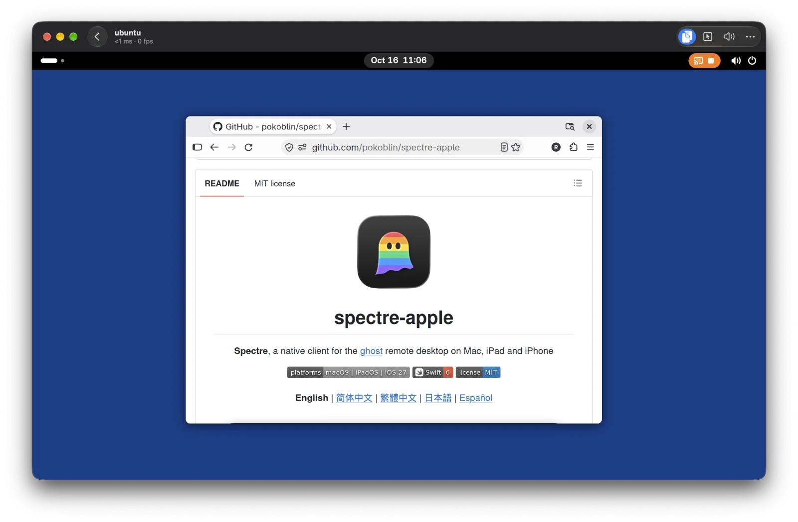
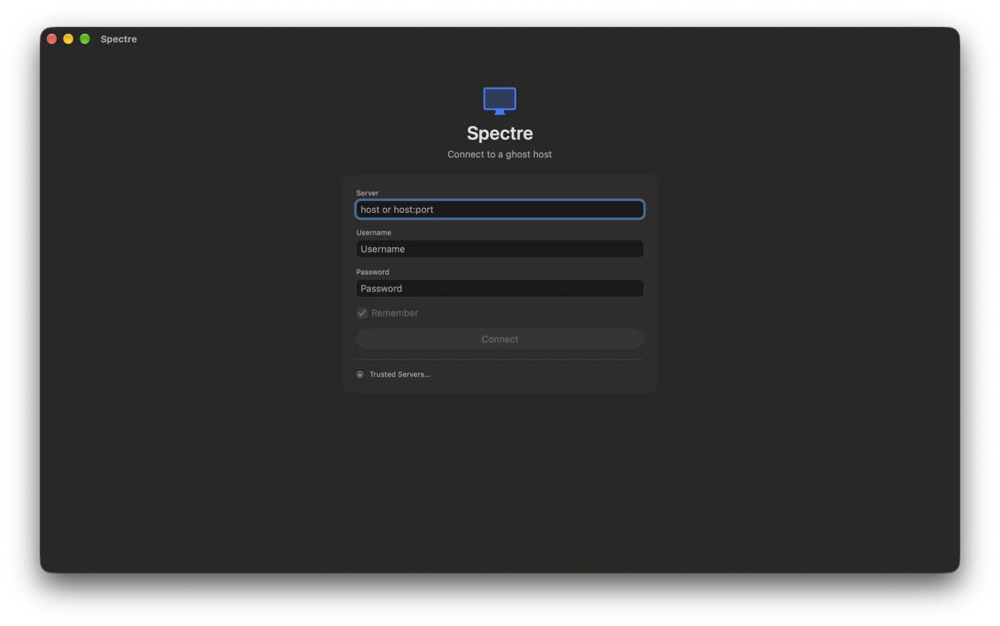
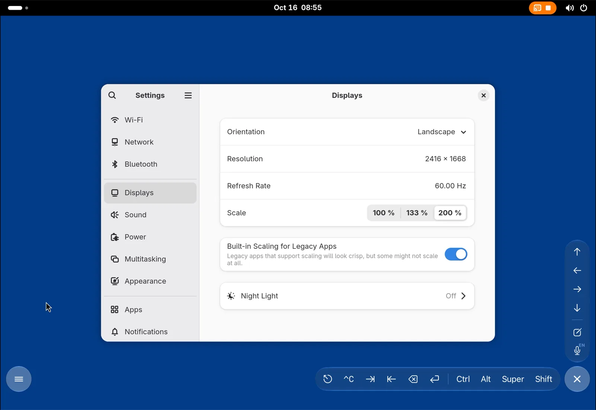

<div align="center">



# spectre-apple

**Spectre**, a native client for the [ghost](https://github.com/jsaiko/ghost) remote desktop on Mac, iPad and iPhone

[](#requirements)
[](https://www.swift.org)
[](LICENSE)

**English** | [简体中文](README.zh-Hans.md) | [繁體中文](README.zh-Hant.md) | [日本語](README.ja.md) | [Español](README.es.md)

</div>



ghost is an open-source remote desktop system: a host (wraith) streams a Linux desktop over the GDP protocol, and a client shows it and sends input back. spectre-apple brings that client to Apple devices as a native app, written in Swift with SwiftUI, Metal and VideoToolbox, on top of ghost's own protocol library, libgdp.

spectre-apple is an independent, third-party client inspired by ghost; it is not part of the ghost project. See [Acknowledgements](#acknowledgements).

## Features

**Signing in**

- Sign in to a ghost server with your user name and password; further prompts, such as a one-time code, are asked in turn. Then choose a device and a desktop session, or take over one that is already running.
- Trust on first use: you confirm the server's certificate fingerprint on the first connection, and it is remembered. **Trusted Servers…** (in the app menu on the Mac, in the home screen's sidebar menu on iPad and iPhone) lists the remembered fingerprints and lets you forget them.
- Tick **Remember** to keep a login in the Keychain, on this device only; the host then connects with one click or tap.
- A lost connection (Wi-Fi changing, the Mac going to sleep, iOS suspending the app) reconnects by itself.

**Picture and sound**

- H.264 and HEVC, decoded in hardware by VideoToolbox and shown with Metal without copying frames; frame loss and latency are reported back to the host.
- The remote desktop is resized to fit the window, or the screen on iPad and iPhone. **Resolution** in the session's More menu turns this off, or asks for the full Retina resolution.
- In full screen on the Mac the toolbar and the menu bar slide away and the remote desktop fills the whole screen; push the pointer against the top edge to bring them back. **View → Hide Toolbar in Full Screen** turns this off.
- The remote desktop's sound, with a jitter buffer that conceals lost packets, and a mute button.

**Input**

- Keys are sent by physical position, so the remote keyboard layout decides what they type.
- Mouse with every button and smooth scrolling, and a captured mode with relative motion for games and 3D views. The remote cursor is drawn locally.
- On iPad: hardware keyboards, trackpads and mice, and fingers in either a direct-touch or a trackpad mode.
- On iPhone and iPad: the on-screen keyboard types on the remote desktop, with the key bar above it.

**On the Mac**

- A home window of your hosts, with the last picture of each; every session opens in a window of its own, so you can have several at once. Closing a session's window disconnects.
- The window's toolbar keeps the clipboard, mouse capture and mute at hand, with resolution, gamepads, statistics and Log Out in a More menu; its subtitle shows the round trip and frame rate as you go.
- Connecting, reconnecting and a failed connection show a glass card over the picture, with Retry.
- A **Session** menu in the menu bar: capture the mouse, send the clipboard to the host, and send the key combinations macOS keeps for itself, such as Super+Tab. No new shortcuts, so every key goes to the remote desktop.

**On iPad and iPhone**

- The remote desktop fills the screen. The controls float over it in Liquid Glass and fold into two round buttons in the bottom corners: the session toolbar on the left (More, paste to the host, the keyboard) and a key bar on the right with arrows, Esc, Ctrl+C, Tab, Backspace and Return, Ctrl, Alt, Super and Shift that stay down until the next key, and the combinations iPadOS keeps for itself, such as Super+Tab.
- A prompt panel: write with the iPad's input methods, dictation or paste, then send it all at once to the cursor on the host, through the host's clipboard and Ctrl+Shift+V (or Ctrl+V, or typed).
- Voice input: hold the microphone key and speak (or tap it, speak, and tap again); what you say is written out on the device, in your language, and sent to the cursor on the host like the prompt panel's text.
- Pinch to magnify the picture, or **Fill Screen** in the Session menu; while magnified, the picture follows the pointer near the edges.
- Region alerts: frame part of the remote desktop, such as a terminal's output, and be told when it stops changing (a build finished) or starts changing, with a banner, or a notification while Spectre's window isn't the active one.
- A home screen of your hosts with the last picture of each, and a **Session** menu in the iPad menu bar, with no shortcuts that would take keys from the remote desktop.

**Sharing**

- Text clipboard in both directions, off until you switch it on.
- Up to four game controllers, forwarded as standard gamepads.

**And also**

- Disconnect (the remote session keeps running) or log out (it ends).
- The interface is in English, Simplified Chinese, Traditional Chinese, Japanese and Spanish, following the system's language.

### Roadmap

Not done yet:

- The lossless refinement layer (refine), and the AV1 and PyroWave codecs
- Sending your microphone to the remote desktop: written and tested, turned off for now
- Checking certificates issued by a certificate authority on iOS (for now they are trusted on first use, like any other)

## Screenshots

| Signing in on the Mac | A session on iPad |
|---|---|
|  |  |

## Requirements

- A Mac with Apple silicon running macOS 27, or an iPhone or iPad running iOS or iPadOS 27 (arm64 only)
- A ghost host to connect to (ghostd and wraith); see the [ghost](https://github.com/jsaiko/ghost) project for setting one up

## Getting started

The Mac app is on [GitHub Releases](https://github.com/pokoblin/spectre-apple/releases/latest): download the `.dmg`, open it and drag Spectre to Applications. It is signed with a Developer ID and notarized by Apple.

For iPhone and iPad, or to work on Spectre, build it from source as below.

### Tools

- Xcode 27, with the iOS 27 simulator runtime
- [XcodeGen](https://github.com/yonaskolb/XcodeGen)
- `cmake` (3.25 or later) and `ninja`: `brew install cmake ninja`
- [vcpkg](https://github.com/microsoft/vcpkg), ideally at the commit upstream's CI uses:

```bash
git clone https://github.com/microsoft/vcpkg ~/src/vcpkg
```

```bash
git -C ~/src/vcpkg checkout 07f4812200df3d3c931c0c8a6081d3b21fe2bf9f
```

```bash
~/src/vcpkg/bootstrap-vcpkg.sh -disableMetrics
```

If you keep vcpkg somewhere other than `~/src/vcpkg`, set `VCPKG_ROOT`.

### Build

1. Clone the repository with the upstream ghost submodule (in an existing clone, run `git submodule update --init`):

   ```bash
   git clone --recurse-submodules https://github.com/pokoblin/spectre-apple.git
   ```

2. Build `GDPCore.xcframework`, which holds libgdp, its dependencies and a small C bridge. It is written to `Packages/GDPKit/Artifacts/` and is not committed. The first build takes a few minutes; later ones reuse vcpkg's binary cache. Logs go to `build/logs/`.

   ```bash
   scripts/build-gdpcore.sh
   ```

   It builds the `macos`, `ios` and `ios-simulator` slices; name some of them to build only those, for example `scripts/build-gdpcore.sh macos`.

3. Generate the Xcode project, then open `Spectre.xcodeproj` and run the `Spectre` scheme:

   ```bash
   xcodegen generate
   ```

   Or build the Mac app from the command line:

   ```bash
   xcodebuild -project Spectre.xcodeproj -scheme Spectre -destination 'platform=macOS,arch=arm64' -configuration Release -derivedDataPath build/DerivedData build
   ```

4. To keep the Mac app, copy it to Applications:

   ```bash
   ditto build/DerivedData/Build/Products/Release/Spectre.app /Applications/Spectre.app
   ```

To run Spectre on an iPhone or iPad, choose your development team for the target in Xcode.

## Usage

Spectre opens on a home screen of your hosts. Add a server with **+** (`host` or `host:port`; the port defaults to 4442) and your user name on it, then click or tap **Connect**: enter your password and choose a desktop. On the first connection you are asked to confirm the server's certificate fingerprint. If the server asks for anything else, such as a one-time code, it is asked on its own; leave the password empty to answer every prompt that way.

On the Mac the home screen is a window of its own, and each session opens in another window; closing it disconnects, and the desktop session keeps running on the host. On iPad and iPhone the session covers the home screen.

### Keyboard and mouse

Cmd is sent as Super (the Windows key), so copy and paste on the remote desktop are still Ctrl+C and Ctrl+V. Only these shortcuts stay on your Mac:

| Shortcut | Action |
|---|---|
| Ctrl+Cmd+G | Capture or release the mouse (also the Capture Mouse button in the toolbar) |
| Ctrl+Cmd+F | Full screen |
| Cmd+Q | Quit |

### Touch on iPad and iPhone

**More › Input Mode** in the session toolbar switches between two modes:

- **Touch**: the pointer goes where you touch. Tap to click, long-press to right-click, drag with one finger to drag, drag with two fingers to scroll, and tap with two or three fingers for a right or middle click.
- **Trackpad** (the default): the screen works like a trackpad. Move the cursor with one finger and tap to click.

### Sound

The remote desktop's sound plays whenever the host sends it (wraith does when it can capture the session's audio). **Mute** in the toolbar (on iPad and iPhone, the More menu) silences it on this device only, and the setting is remembered.

Sending your microphone to the remote desktop is turned off for now. On iPad and iPhone the microphone is for voice input instead: hold the microphone key on the key bar and speak, and what you say is written out on the device and typed at the cursor on the host.

## Development

### Tests

```bash
swift test --package-path Packages/GDPKit
```

```bash
swift test --package-path Packages/SpectreKit
```

Both packages include an in-process test host and test lobby, so the end-to-end tests run over a real QUIC connection on the loopback interface. SpectreKit's tests also decode H.264 and HEVC colour bars and render them with Metal. To run them in the iPad simulator:

```bash
(cd Packages/GDPKit && xcodebuild test -scheme GDPKit -destination 'platform=iOS Simulator,name=iPad Pro 13-inch (M5),OS=27.0' -derivedDataPath ../../build/DerivedData-GDPKit)
```

```bash
(cd Packages/SpectreKit && xcodebuild test -scheme SpectreKit -destination 'platform=iOS Simulator,name=iPad Pro 13-inch (M5),OS=27.0' -derivedDataPath ../../build/DerivedData-SpectreKit)
```

### Running without a server

With any of the options below, Spectre skips the login and starts playing. It first encodes a 10-second 1080p60 test stream with VideoToolbox (about 3 seconds), then loops it. Decode, presentation and session statistics appear at the top left and are printed to stdout every second; the toolbar switches the source, the codec and the presentation pacing. There are three sources:

- **Loopback** (the default): a test host inside the app sends the stream over a real GDP session (QUIC on 127.0.0.1). It also beeps once a second, to test sound.
- **Direct**: the stream goes straight to the decoder, with no network.
- **Remote**: a wraith started with a static token (§6.11 of the specification):

```bash
build/DerivedData/Build/Products/Release/Spectre.app/Contents/MacOS/Spectre --connect HOST:PORT --token TOKEN --fingerprint SHA256
```

Benchmark mode measures for N seconds after a 2-second warm-up, prints the statistics and quits:

```bash
build/DerivedData/Build/Products/Release/Spectre.app/Contents/MacOS/Spectre --bench 60 --codec h265
```

Other options: `--source loopback|direct`, `--codec h264|h265`, `--mode onArrival|displayLink`, `--in-flight <N, 0 for no limit>`, `--screen <screen index>`, `--rate <display link Hz>`, `--min-present-ms <ms>`, and `--host-clipboard <text>` (the loopback host's initial clipboard).

### iOS and iPadOS simulator

```bash
xcodebuild -project Spectre.xcodeproj -scheme Spectre -destination 'platform=iOS Simulator,name=iPad Pro 13-inch (M5),OS=27.0' -configuration Release -derivedDataPath build/DerivedData build
```

```bash
xcrun simctl install booted build/DerivedData/Build/Products/Release-iphonesimulator/Spectre.app
```

```bash
xcrun simctl launch --console-pty booted org.ghost.spectre.apple --source loopback
```

On iOS the app starts from a UIKit app delegate, so that its root view controller can lock the pointer (see [docs/input.md](docs/input.md)). If a build from before that change is installed, uninstall it once with `xcrun simctl uninstall booted org.ghost.spectre.apple`; otherwise the system restores the old window and it stays black.

The simulator decodes video in software and reports no `presentedTime`, so its timings can't be compared with a device or a Mac.

### Project layout

| Path | Contents |
|---|---|
| `project.yml` | The XcodeGen project: one multiplatform app target for macOS and iOS |
| `App/` | The app: per-platform entry points, the home screen and sign-in sheets, the session UI, the iPad and iPhone floating controls, the icon |
| `Packages/GDPKit/` | The C bridge to libgdp (`Native/`) and its Swift wrapper: sessions, lobby, test host |
| `Packages/SpectreKit/` | Shared code: the session, VideoToolbox decoding, Metal presentation, input, the login flow |
| `scripts/` | Builds the dependencies and the xcframework |
| `docs/` | Design notes and measurements, in Simplified Chinese |
| `experiments/` | One-off experiments, such as a Swift/C++ interop probe; not part of the app |
| `third_party/ghost/` | Upstream ghost, as a read-only git submodule |

### Design notes

The notes under [`docs/`](docs/) record how each part works, what was measured and what went wrong along the way. They are written in Simplified Chinese.

- [prototype-findings.md](docs/prototype-findings.md): the prototype's three technical risks and how each was settled (calling libgdp from Swift, zero-copy presentation, cross-compiling for iOS)
- [session-client.md](docs/session-client.md): the session layer, checked against §6–§11 of the specification
- [login.md](docs/login.md): lobby login and certificate trust
- [saved-logins.md](docs/saved-logins.md): saved passwords in the Keychain, one-tap sign-in
- [reconnect.md](docs/reconnect.md): reconnecting a lost session, replaying the login, iOS in the background
- [keep-alive.md](docs/keep-alive.md): QUIC keep-alive, and how long a lost connection takes to notice
- [resolution.md](docs/resolution.md): resizing the remote desktop to fit the window
- [full-screen.md](docs/full-screen.md): hiding the toolbar in full screen on the Mac
- [input.md](docs/input.md): keyboard, mouse, cursor and touch
- [keyboard.md](docs/keyboard.md): the on-screen keyboard on iOS, characters to keys, the key bar
- [ipad-layout.md](docs/ipad-layout.md): the iPad and iPhone interface: the floating controls, the key bar, the prompt panel, magnifying, the home screen, region alerts
- [macos-layout.md](docs/macos-layout.md): the Mac interface: the home window, a window for each session, the toolbar, the Session menu
- [audio.md](docs/audio.md): sound, the jitter buffer, Opus decoding, the microphone
- [voice-input.md](docs/voice-input.md): voice input, Speech's on-device models, the microphone key
- [clipboard.md](docs/clipboard.md): the clipboard on the Mac and on iPad, echo suppression, the paste prompt
- [gamepad.md](docs/gamepad.md): game controllers, the button mapping, the Home button
- [localization.md](docs/localization.md): the interface languages, the glossary, adding a string
- [app-icon.md](docs/app-icon.md): the app icon and how to change it

## Contributing

Issues and pull requests are welcome; for larger changes, please open an issue first. A few things to know:

- The client is written from the GDP specification (`third_party/ghost/docs/spec/gdp-spec.md`) and public standards. Most of upstream ghost is GPL-3.0, so please don't copy or port code from it, including upstream's own spectre client; only `libgdp/` and the specification are MIT.
- Run both packages' tests before sending a change, and update the matching note under `docs/` when behaviour changes.
- New interface text needs translations for every language in the String Catalogs; see [docs/localization.md](docs/localization.md).

## Acknowledgements

spectre-apple is inspired by [ghost](https://github.com/jsaiko/ghost) by [Joseph Saiko](https://saiko.dev), a complete remote desktop system made up of the GDP protocol, the wraith host and the spectre client for Linux. This project uses ghost's protocol library, libgdp, is written from ghost's published protocol specification and design documents, and borrows the name Spectre from the upstream client. Many thanks to the author for open-sourcing ghost and for releasing libgdp and the protocol specification under the MIT license; this project would not exist without them.

spectre-apple is an independent, third-party client and is not part of the ghost project.

## License

[MIT](LICENSE).

- In upstream ghost, `libgdp/` and the protocol specification are MIT, and everything else (including upstream's own spectre client) is GPL-3.0-only. This project builds only `libgdp/`; its client code is written from the specification and public standards, and no code from the GPL parts is copied or ported.
- The app links ngtcp2, OpenSSL, Protocol Buffers, Abseil and zstd statically, all under permissive licenses (MIT, Apache-2.0, BSD-3-Clause). A binary distribution must include their notices: see [THIRD_PARTY_NOTICES.md](THIRD_PARTY_NOTICES.md).
