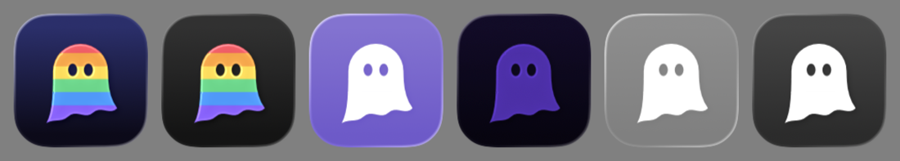

# App 图标



一个由光谱色带组成的幽灵剪影，飘在靛蓝到近黑的渐变上。Spectre 是"幽灵"，也让人想到 spectrum（光谱）。macOS、iPadOS、iOS 共用这一个图标。

上游 ghost 的图标（`third_party/ghost/assets/`，黑白的幽灵抱着显示器）是 GPL-3.0，这里没有复制，也没有照着改画。这个图标是重新画的，构图、配色都不同，和项目其余部分一样以 MIT 发布。

## 文件

```
App/Shared/AppIcon.icon/     Icon Composer 格式（Xcode 26 起）
  icon.json                  背景渐变、图层、阴影，以及着色外观下的填充
  Assets/ghost.svg           幽灵：clipPath 剪出的六条色带，眼睛是镂空
```

`project.yml` 里设置了 `ASSETCATALOG_COMPILER_APPICON_NAME: AppIcon`。XcodeGen 把 `AppIcon.icon` 识别成一个资源（`wrapper.icon`）而不是文件夹，actool 编译时生成 `Assets.car`；macOS 上还会额外生成 `AppIcon.icns`。不需要再放一套 PNG 版的 Asset Catalog：部署目标是 27，系统直接读 `.icon` 编译出的结果。

## 设计

- **背景**：线性渐变，从 `#2A2F6E`（靛蓝）到 `#0C0A1A`（近黑），写在 `icon.json` 的 `fill` 里。渐变刻意做得很淡，让光谱色成为主角。
- **幽灵**：圆顶加向外张开的裙摆，波浪下摆向左下拖出一条尾巴，像在飘动。最初画的是直筒身体加三个扇形下摆，看起来太像吃豆人里的幽灵，所以改了。
- **色带**：自上而下是 `#FF4D5E` `#FF9F2E` `#FFD83A` `#34D883` `#2E9BFF` `#8B5CFF`。色带之间是硬边，没有渐变，这样 16 px 下也认得出来。每条色带都往下多画 4 px，压在下一条下面；没有重叠时，抗锯齿会在色带之间留下细缝，在着色外观里尤其明显。
- **眼睛**：剪切路径用 `clip-rule="evenodd"`，所以眼睛是透明的洞，直接透出背景。这样无论哪种外观，眼睛都和背景一致，不需要另画一个跟着背景变色的图层。
- **着色外观**：系统按图层亮度给图标着色。几条色带的亮度接近，着色后幽灵变成一块暗紫色，在深色模式下几乎看不见。所以 `icon.json` 给幽灵图层加了 `fill-specializations`，着色外观下改用纯白填充。实际渲染出来，透明外观也用了这个白色填充（见上图最右两个）。
- **Liquid Glass**：边缘高光和阴影由系统渲染，`translucency` 关闭，免得色带透出背景变灰。

## 修改

用 Xcode 自带的 Icon Composer 打开 `App/Shared/AppIcon.icon` 就能改。也可以直接编辑 SVG 和 JSON，再用 Icon Composer 自带的命令行工具渲染出来检查：

```bash
"/Applications/Icon Composer.app/Contents/Executables/ictool" App/Shared/AppIcon.icon --export-image --output-file icon.png --platform iOS --rendition Default --width 1024 --height 1024 --scale 1
```

`--rendition` 可选 `Default`、`Dark`、`TintedLight`、`TintedDark`、`ClearLight`、`ClearDark`。注意 `/usr/bin/ictool` 是另一个工具（属于 actool），不认这些参数。本文的两张预览图 `images/app-icon.png` 和 `images/app-icon-appearances.png` 就是这样导出的，改了图标之后要一并重新导出。

## 验证

- `ictool` 渲染了 1024、256、64、32、16 px 和全部六种外观。16 px 下仍能认出是一个彩色幽灵。
- macOS：Debug 构建的 `Spectre.app` 里有 `AppIcon.icns` 和 `Assets.car`，Info.plist 里有 `CFBundleIconName = AppIcon`；icns 转成 PNG 后和 `ictool` 的渲染一致。
- iPad 模拟器（iPad Pro 13-inch M5，深色模式）：主屏和 Dock 上都显示这个图标。
