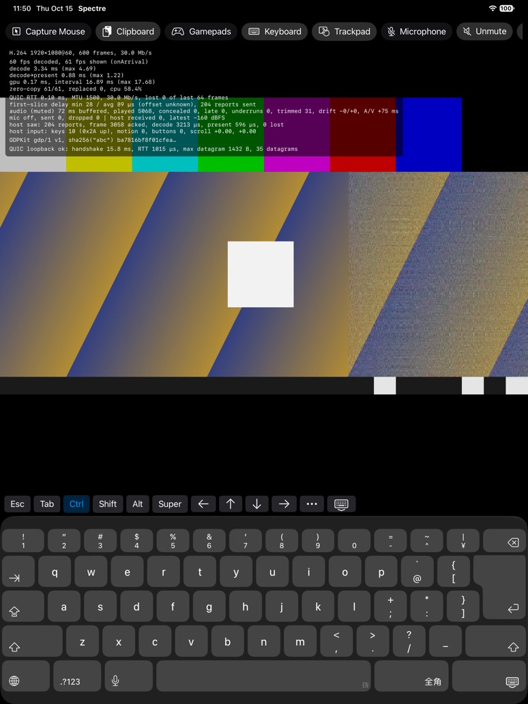

# 屏幕软键盘（iOS / iPadOS）

没有外接键盘的 iPhone 和 iPad 用系统软键盘打字。§8.2 只有物理键位（`KeyEvent` 发 HID usage，host 用**它自己的**键盘布局解释），协议里没有发送文本的消息，所以软键盘给出的字符要在客户端换算回“哪个键 + 要不要按 Shift”。上游只有浏览器客户端，用的也是物理键位（`KeyboardEvent.code`），没有可参考的软键盘设计，这里的做法是自己定的。



## 分层

```
App/Shared/ContentView            iOS 工具栏的 Keyboard 开关；“打不出来”的提示；画面避开键盘
  └ SpectreKit/Input
      ├ IOSSessionView            实现 UIKeyInput：insertText / deleteBackward；inputView 控制显隐
      ├ TouchKeyboardBar          键盘上方的附加键条（inputAccessoryView）
      ├ SessionInput              showsTouchKeyboard、type(_:)、untypable
      ├ TextTyper                 字符 → 按键序列；粘滞修饰键；按住
      └ KeyboardLayout            每种布局一张表，目前只有 US QWERTY
          └ InputSender           和硬件键盘共用：按住的键都记着，releaseAll 照样有效
```

## 字符怎么变成按键

- **假设 host 是 US QWERTY**：`KeyboardLayout.usQWERTY` 覆盖全部可打印 ASCII（0x20–0x7E），加上 Tab 和回车（`\n`、`\r`、`\r\n`）。大写字母和上档符号带 Shift，例如 `A` = Shift+a，`!` = Shift+1，`"` = Shift+'。按布局分表存放，以后加 UK、德语等只要加表。
- **每个字符一次完整的按键**：按下修饰键 → 按下键 → 松开键 → 反序松开修饰键。不会有键留在按下状态；同一个 Shift 只按一次（字符本身要 Shift、Shift 又被锁定时）。
- **打不出来的字符**（é、汉字、emoji、听写给出的非 ASCII）：跳过，并在画面底部提示 “N 个字符无法在 host 的 US 布局上输入，其他文字请用 host 的输入法”。
- **中文**：软键盘固定为 ASCII 键盘（`keyboardType = .asciiCapable`），切换不到中文或 emoji 键盘。打中文的方式是在 host 上打开输入法（IBus、Fcitx 等），然后在 iPad 上照常打拼音字母，由 host 转换成汉字，和外接实体键盘时一样。
- **退格**：`deleteBackward` 发 Backspace。`hasText` 始终为真，否则 iOS 在它认为“没有文字”时不会再调用 `deleteBackward`。
- **关掉一切会改字的功能**：自动纠错、自动大写、拼写检查、智能引号和破折号、智能插入删除、行内预测都关闭，否则系统会在用户背后删改已经发出去的字符。

## 附加键条

软键盘上缺的键放在键盘上方的一排里（`inputAccessoryView`，窄屏上可以横向滑动）：

| 键 | 行为 |
|---|---|
| Esc、Tab | 按住期间保持按下 |
| Ctrl、Shift、Alt、Super | **粘滞**：点一下，只对下一个键生效（浅色高亮）；0.35 秒内连点两下则锁定（实心高亮），直到再点一下。所以 Ctrl+C 是先点 Ctrl 再打 c；Shift 锁定后连按方向键可以选中文字 |
| ← ↑ ↓ → | 手指按住期间保持按下、松手才松开，由 host 自己连发，和实体键盘一样 |
| ⋯ | 菜单：F1–F12、Home、End、Page Up、Page Down、Delete、Insert、Print Screen、Menu |
| ⌨︎↓ | 收起键盘 |

修饰键用的都是左侧的键（Left Control 0xE0、Left Shift 0xE1、Left Alt 0xE2、Left GUI 0xE3）。修饰键只在按键的那一刻按下，所以“锁定”不会让 host 上一直按着某个键；收起键盘时所有锁定都会清掉。

## 显示与收起

- **用 `UIKeyInput` 而不是隐藏的输入框**：`IOSSessionView` 本来就是第一响应者，用 `pressesBegan` 处理硬件键盘，并且**不调用 super**，所以硬件按键不会再变成 `insertText`，同一个键不会发两次（实测：硬件的 Cmd+V 只作为 Super+V 转发了一次）。软键盘的点击不产生 `UIPress`，只会走 `insertText`。
- **显隐靠 `inputView`**：收起时返回一个空 view 顶替系统键盘，打开时返回 nil，再调用 `reloadInputViews()`。不用切换第一响应者，硬件键盘和指针的处理不受影响。
- **跟随系统**：用户用键盘自带的收起键、或者接上硬件键盘时，系统会收起软键盘（`keyboardDidHide`），工具栏的开关随之变成关。接着硬件键盘时打开开关，只显示附加键条（贴在屏幕底部），方便按 Super、F 键这类实体键盘上可能没有的键。
- **画面避开键盘**：画面不再忽略键盘的安全区域（`ignoresSafeArea(.container)`），键盘弹出时视图缩小到键盘上方，画面等比缩放、完整可见；指针的坐标映射用的是视图尺寸，自动跟着变。收起后恢复全屏。
- **工具栏**：iOS 的工具栏按钮越来越多，iPhone 上放不下，改成可以横向滚动。

## 测试

- **SpectreKitTests**（新增 13 个）：
  - `KeyboardLayout`：每个可打印 ASCII 字符都有键；字母、数字、符号、空格、回车、Tab 的对应；é、中、😀、€、DEL 没有键。
  - `TextTyper`：字符变成按键序列（含 Shift）；打不出来的字符跳过并计数；点一下的修饰键只作用于下一个键；锁定的修饰键一直有效、再点一下解除；字符和锁定都要 Shift 时只按一次；连点两次关闭；按住的键直到松手才松开、期间修饰键保持；打字或清除锁定会先松开按住的键。
  - `SessionInput`：打不出来的字符计入 `untypable`（每次递增 `serial`）；收起键盘清掉锁定。

## 实测

**iPad 模拟器（iPad Pro 13-inch (M5)，iOS 27.0），loopback**：

- 打开 Keyboard：系统软键盘和附加键条出现，画面缩小到键盘上方。模拟器的软键盘是日文罗马字的 ASCII 布局（有 ¥、全角键），这跟模拟器的语言设置有关，不影响字符映射。
- 点 h、i、空格、退格：host 收到 h、i、空格、退格各一次按下和松开（0x0B、0x0C、0x2C、0x2A）。这一批里还点了 Ctrl，因为几次点击是同时发出的，Ctrl 先落下，所以 h 带上了 Ctrl：`Ctrl↓ h↓↑ Ctrl↑`，正好也验证了“点一下只作用于下一个键”。
- 再逐个点 Ctrl、c：Ctrl 变成浅色高亮，host 收到 `Ctrl↓ c↓↑ Ctrl↑`，之后高亮消失。双击 Shift 变成实心高亮，再点两次 →、点一下 Shift：host 收到两组 `Shift↓ →↓↑ Shift↑`，然后锁定解除。
- 在左方向键上按住约 1.2 秒：host 先收到按下，约 1.2 秒后才收到松开。
- 模拟器控制工具的 “输入文字” 实际上是用硬件键盘的 Cmd+V 粘贴：它让系统认为接了硬件键盘，软键盘随即收起，开关同步变成关；Cmd+V 只作为 Super+V 转发了一次，没有经 `insertText` 再发一遍。之后再打开开关，只显示附加键条；点键条上的收起键，键条消失、画面恢复全屏。
- 打不出来的字符在 ASCII 软键盘上点不出来，提示只靠单元测试覆盖。

**iPhone 模拟器（iPhone 17，iOS 27.0）**：工具栏可以横向滑动找到 Keyboard；打开后画面缩小到键盘上方，附加键条可以横向滑动，点 q 时 host 收到 0x14。

**没有在真机上验证的**：真机键盘、听写（会给出非 ASCII 字符和整句文字）、host 上用输入法打中文的实际体验。

## 没有做的

- 其他 host 布局（UK、德语、法语等）和对应的设置：表的结构已经留好。
- 把打不出来的字符经剪贴板加 Ctrl+V 发过去：会覆盖 host 的剪贴板，终端里的粘贴键也不同，剪贴板和按键又走不同的流、没有先后顺序保证。
- 软键盘弹出时把画面平移到输入位置（保持原大小）：远端的输入位置未知，只能按指针位置猜。
