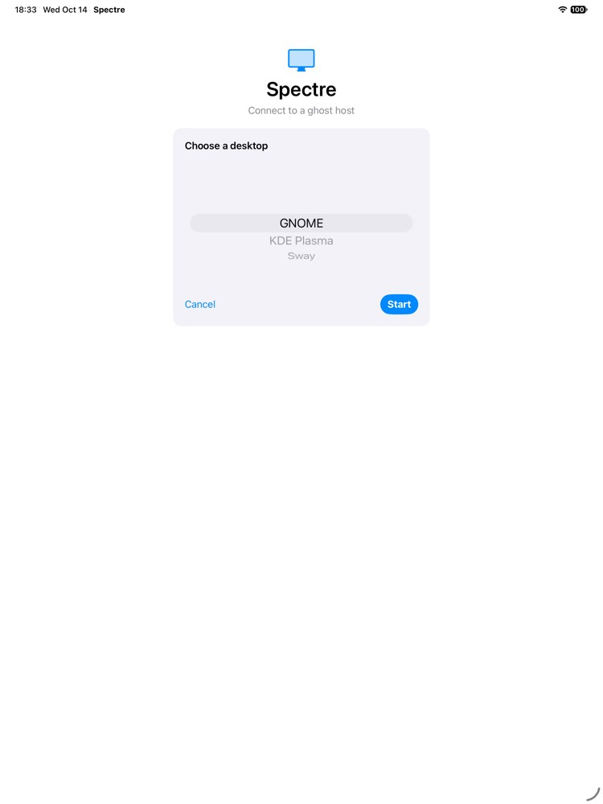
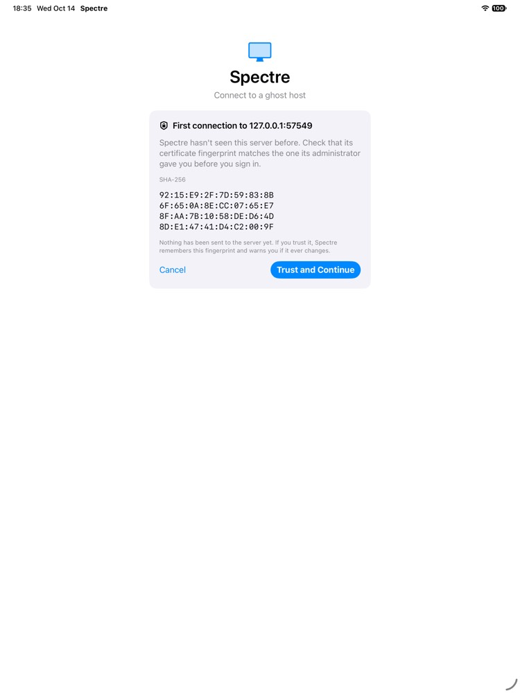

# 登录（lobby）

照 gdp-spec §2.3（证书）、§4（lobby）、§5（broker）实现。协议本身用的是 libgdp 的 `gdp::LobbyClient`（MIT），这里只加了 C ABI、Swift 封装、信任模型和界面。

| 选择桌面 | 会话 |
|---|---|
|  |  |



## 分层

```
App/Shared/LoginView      每一步一个卡片：表单 → 信任确认 / 证书已变 → 提示 → 选设备 → 选桌面
App/Shared/AppModel       登录页 ↔ 会话页；最近登录；演示服务器
  └ SpectreKit.LoginFlow  与界面无关的状态机（@MainActor @Observable）
      ├ KnownHosts        TOFU 指纹，JSON 文件，按 主机名:端口
      ├ ServerAddress     解析 host、host:port、[v6]、[v6]:port，默认端口 4442
      └ GDPKit.GDPLobby   串行队列 + notify_fd 读源；gdpc_lobby_* → gdp::LobbyClient
```

## 流程

1. 输入服务器和用户名，点 Connect。
2. TLS 握手完成后、发送任何数据（包括用户名）之前，先判断是否信任证书（§2.3）：
   - 指纹和已保存的一致：继续；
   - 证书由 CA 签发且对所输入的名字有效：继续，而且不保存指纹（规范要求 SHOULD NOT 保存，因为证书续期后指纹会变；即使已保存了另一个指纹也照样接受）；
   - 否则拒绝本次连接。如果没有保存过这个服务器，就显示**首次连接**确认（指纹 4 行、每行 8 对）；用户确认后保存指纹并自动重连。如果保存过、但和这次不一样，就显示**证书已变**警告：这一步没有"仍然继续"按钮，只能取消，或者在二次确认后**删除已保存的指纹**，下次连接时按新服务器重新询问（相当于上游删掉 known_hosts 里的那一行）。
3. 服务器的每个提示（§4.5）各显示一轮：`echo_input` 为 false 时用密码框，提示文字照原样显示。不假定第一个提示一定是密码。
4. 如果是 broker（§5），会收到设备列表：显示在线状态和是否已有会话，离线的设备不能选。选好后，被选主机的第二因素等提示也照样逐轮显示。
5. 选择桌面类型，默认选中服务器给的 `default_type`。如果已经有会话在运行，提示会回到这个会话，因为规范规定此时 SessionOpen 不论选哪种类型都会重新连上它。如果这个会话正被别的客户端查看，必须先打开 "Take over" 开关，否则按钮不可点（§4.6、§6.4）。
6. 收到 Redirect 后立即打开会话（token 只有约 30 秒有效，§4.8）：`host` 为空时由 libgdp 换成登录时输入的名字（§4.7）；`cert_sha256` 格式不对就不打开会话；`take_over` 用第 5 步的选择。
7. 会话结束（断开、注销、被别人顶替、host 关闭）后回到登录页，显示原因，最近登录里会多一条。

各种失败的提示文字按 §12 的错误码给出，例如：20 → "Wrong username or password."，23 → 在 host 本机登录着，30 → host 离线，24（会话阶段）→ 有人在看，重新登录时选择 take over。

## 不同平台

- **iOS 上不做 CA 校验**：libgdp 在 Apple 平台上从 `/etc/ssl/cert.pem` 读系统根证书，iOS 沙盒里没有这个文件。所以 iOS 上 `trustSystemCAs` 默认关闭，CA 签发的证书也按 TOFU 处理，这是 §2.3 允许的（证书验证不通过时必须退回到指纹固定）。要在 iOS 上做 CA 校验，需要 libgdp 把对端证书链交出来，再交给 Security.framework 验证，可以以后向上游提。
- **密码不保存**：现在每次登录都要重新输入。以后可以接入 Keychain 和系统的"密码"自动填充（密码框已经设置了 `textContentType(.password)`）。

## 测试服务器和演示

`gdpcore::TestLobby` 是照 §4/§5 写的最小 lobby 服务端：一个账号、按顺序给出的提示、桌面类型列表、可选的已运行会话（可以设成有人在看）、可选的 broker 设备列表（含离线设备和第二因素提示）、认证后拒绝的错误码，最后 Redirect 到指定的会话 host。它和 TestHost 都改用共用的 `ServerLoop`（证书 + 监听 + 线程 + 命令队列）。

App 登录页的 **Try the demo host** 会在 App 内同时启动 TestLobby（用户 demo，密码 demo，三种桌面）和 LoopbackHost（经 QUIC 播放测试码流），并把地址填进表单。没有服务器也能走完整个流程，包括首次连接的信任确认。

## 测试

- **GDPKit**：9 个 lobby 测试。密码登录 → Redirect → 用它建立会话；多轮提示及各自的 echo 标志；密码错误（20）；拒绝证书时服务端收不到 hello；broker 的设备列表、类型、第二因素和 Redirect（§5.4 由 broker 设置 host）；离线（30）、不属于此用户（22）、未知类型（14）；认证后拒绝（23）；已有会话且有人在看；参数错误。
- **SpectreKit**：地址解析（8 个合法、8 个非法）、KnownHosts 持久化（按名字和端口，名字不区分大小写）、LoginFlow 6 个流程：首次信任后登录、已保存指纹时不再询问、证书已变时拒绝（"信任"按钮无效，只能删除）、有人在看时必须 take over、密码错误的提示、broker 设备选择。
- **手动**：iPad 模拟器上用演示服务器完整走过：信任 → 密码 → 选 KDE Plasma → 会话 → 注销（回到登录页，显示 "The session ended."）→ 再次登录不再询问证书 → 密码错误的提示。macOS 上走到了密码提示：computer-use 不能向安全输入框打字，后面几步由测试覆盖。

## Redirect 之后的 lobby 连接

§4.2：服务器发出 `Redirect` 之后，由它用错误码 0 关闭连接。原先客户端一拿到 Redirect 就销毁 lobby 连接，正好撞上服务器自己的关闭，ghostd 的日志里于是每次登录都有一条 `lobby: connection handler failed ... error=connection lost`。现在 `GDPLobby` 收到 Redirect 后不再接受命令，但会继续驱动连接，直到服务器关闭（C 桥接层的 `gdpc_lobby_connection_closed`）再销毁；服务器若 2 秒内没有关闭，就由客户端关闭。这段时间里对象自己持有自己，所以 `LoginFlow` 照常在 Redirect 时放开它；会话连接同时照常建立，不受影响。测试 `redirectWaitsForTheServersClose` 确认连接是由测试 lobby 的关闭结束的，而且远早于 2 秒。

## 踩过的坑

- **Swift 6 的隔离推断**：在 `@MainActor` 的 LoginFlow 里创建的回调闭包会被推断为只能在主线程运行，而 GDPLobby 是在自己的队列上调用它们，结果运行时检查失败，测试进程直接 trap。现在 GDPLobby 和 GDPSession 的回调都声明为 `@Sendable`，这本来也是正确的接口：回调就是在别的队列上被调用的。
- **`Mutex` 不能被闭包捕获**（不可复制），要包在一个 `final class` 里。
- **iPad 上较大的等宽字体放不下每行 16 对的指纹**，改成每行 8 对。
- **App 在后台时编码演示码流明显变慢**，所以演示码流从 600 帧减到 300 帧。

## 以后

- Keychain 保存密码，和系统"密码"自动填充集成。（断线重连用的登录配方只存在内存里，见 [reconnect.md](reconnect.md)。）
- 管理已保存指纹的界面（现在只能在"证书已变"时删除）。
- iOS 上的 CA 校验（见上）。
- 界面文字目前是英文，之后统一做本地化（工程的开发语言已设为 zh-Hans）。
