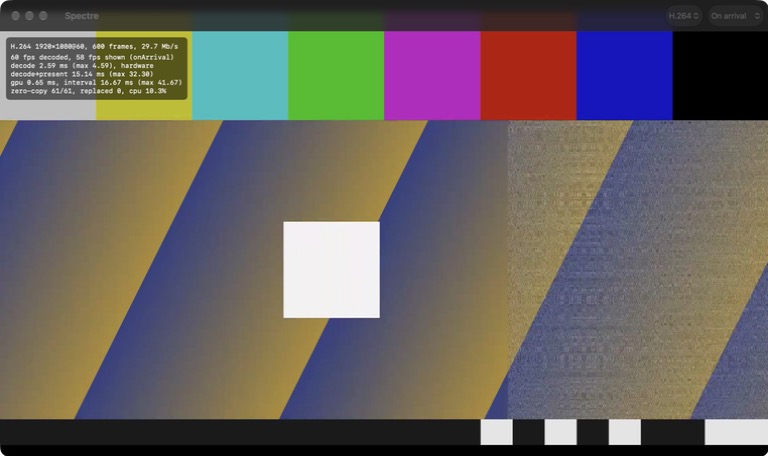

# 原型验证结论

原型验证三个关键风险：

1. Swift 能调用 libgdp（GDPKit）
2. VideoToolbox 解出的帧零拷贝交给 Metal 显示
3. libgdp 能交叉编译成 iOS 版

## 环境

- Apple M4 Pro，macOS 27.0.1，Xcode 27.0（Swift 6.4）
- 上游 ghost `1f0d0c604e1ae8d67252a61f259ff498a049827c`
- vcpkg `07f4812200df3d3c931c0c8a6081d3b21fe2bf9f`（ngtcp2 1.25.0、OpenSSL 3.6.4、protobuf 6.33.4）

## 许可证

本项目 MIT。上游 `client/spectre/`（含 `SessionClient`、着色器）和 `host/gdpnet` 是 GPL-3.0-only，不复制、不移植；会话层照 `docs/spec/gdp-spec.md` 自行实现。libgdp 本身是 MIT，可以直接链接。

## 风险 1：Swift 调用 libgdp（GDPKit）——通过

### 结论

libgdp 及其依赖用 vcpkg 静态编译，和一层 C ABI（`Packages/GDPKit/Native/include/gdpcore.h`）一起合并成一个静态库，打包为 `GDPCore.xcframework`。Swift 端 `GDPKit` 只 `import GDPCore`（纯 C 模块），不开 C++ interop。Swift Testing 的 18 个测试全部通过（`swift test --package-path Packages/GDPKit`），都调用 libgdp 的真实代码：

| 测试组 | 覆盖的 libgdp 功能 |
|---|---|
| Fingerprints (§2.3) | `sha256`（NIST 向量，含 100 万个 `a`）、`sha256_hex`、`is_sha256_hex`（只接受小写 64 位）、`format_fingerprint` |
| Control-stream framing (§3.1) | `encode_frame` 的线上字节、`FrameReader` 在任意分块和逐字节输入下拆出同样的帧、超长长度前缀报 `FRAME_TOO_LARGE`(12)、§6.3 认证前的 16 KiB 上限、坏 protobuf 报 `MALFORMED_FRAME`(11) |
| Video datagrams (§9) | 16 字节头的线上布局（含 `host_lat` 按 10 µs 取整）、`slice_payload_for`、`slice_video_frame` 切片后乱序加重复送入 `VideoFrameReassembler` 能拼回原帧、新 `frame_id` 丢弃未完成的旧帧 |
| QUIC transport | 进程内回环的真实 QUIC 连接（下详） |

QUIC 回环自检（`gdpc_selftest_quic_loopback`）：用 OpenSSL API 现场生成 P-256 自签名证书，libgdp `Transport::listen` + `connect`，核对客户端看到的证书指纹，打开 control/input 两个流，控制流上 Ping/Pong 往返，服务端把一个 48 KiB 的视频帧切成 datagram 发过来，客户端重组后逐字节比对。macOS 上一次典型结果：握手 5.2 ms，RTT 506 µs，路径 MTU 探测后最大 datagram 1432 B，收到 35 个分片。这一项证明 ngtcp2 + OpenSSL 的静态库在当前平台真的能跑，第 3 步在 iOS 模拟器上复用。

### 为什么用 C ABI，而不是 Swift/C++ interop

实测见 `experiments/CxxInteropProbe/`（Swift 6.4，`-cxx-interoperability-mode=default`，直接导入 libgdp 头文件，不改上游）：

| 项目 | 结果 |
|---|---|
| 返回 `std::string` / `std::array` 的普通函数（`sha256_hex`、`format_fingerprint`） | 可用 |
| POD 结构体 + 指针出参（`VideoDatagramHeader::decode`） | 可用 |
| `std::function` 参数（`slice_video_frame`）| **不可用**：Swift 闭包（捕获或不捕获）都不能转换成 `std::function` |
| `std::function` 成员（`LobbyClient::on_error`、`Connection::on_datagram`、`Stream::on_data`……） | **不可用**：不能赋值 Swift 闭包。libgdp 的所有回调都是这种形式 |
| 不可拷贝也不可移动的类（`Transport`、`Connection`、`Stream`、`LobbyClient`） | **默认根本不导入**。外挂 API notes 标成引用类型后能导入，但 libgdp 没有引用计数，只能标 immortal，对象永远不释放；而且 API notes 只在手写 module map 旁边才会被 clang 找到 |
| 抽象类 `ClientConnection`（纯虚 `on_connected()`） | Swift 不能继承 C++ 类，所以 SessionClient 只能用 C++ 写 |
| protobuf 生成的消息（`gdp::session::ControlEnvelope`） | **swift-frontend 6.4 直接崩溃**（在 `session.pb.h` 上做名字查找时） |

另外，C++ interop 会向上传染：导入 C++ 模块的 Swift 模块要开 interop，它的使用者（SpectreKit、App）通常也得开。

所以：协议状态机和热路径（datagram 重组、protobuf、以后的 SessionClient 和 StatsReport）留在 C++，Swift 只通过粗粒度的 C 接口和它打交道（不透明句柄 + C 函数指针回调 + `void *ctx`）。不选 Objective-C++ 是因为每个 datagram 都要走 `objc_msgSend` 和 `NSData` 分配，还会引入 ObjC 运行时。

### 构建方式和取舍

- **vcpkg**：自带清单 `scripts/vcpkg/vcpkg.json`，只有 libgdp 的 4 个依赖（`ngtcp2[openssl]`、`openssl`、`protobuf`、`zstd`），`builtin-baseline` 固定在 `07f48122`。overlay triplet `arm64-{osx,ios,ios-simulator}-spectre`：静态库、只编 release、最低系统 27.0。`arm64-osx-spectre` 同时作为 host triplet（`protoc`）。每个 triplet 单独一个 install root（`build/vcpkg/<triplet>`），因为 manifest 模式会删掉同一 install root 里不属于本次 triplet 的包。首次编译 macOS 依赖约 1.3 分钟（protobuf 37 s、OpenSSL 20 s）。
- **libgdp 不改一行**：`Native/CMakeLists.txt` 用 `add_subdirectory(third_party/ghost/libgdp EXCLUDE_FROM_ALL)`，只构建 `gdpcore` 依赖到的 `gdp` 目标。上游的测试程序是无条件声明的，`EXCLUDE_FROM_ALL` 让它们不参与构建（iOS 上也跑不了）。
- **合并静态库**：`libtool -static` 把 `libgdpcore.a`、`libgdp.a`、protobuf、abseil、utf8_range、ngtcp2、OpenSSL、zstd 合成一个 `libGDPCore.a`，xcframework 的 Headers 里只有 `gdpcore.h` 和 `module.modulemap`。不放 `libprotoc`、`libupb`（编译器用的），也不放 `libprotobuf-lite`（和 `libprotobuf` 符号重复）。
- **体积**：macOS slice 33 MB（RelWithDebInfo，含调试信息；最终链接进 App 时只取用到的目标文件，并会被 strip）。
- **链接**：Swift 端需要链接 libc++（`Package.swift` 的 `linkedLibrary("c++")`）。

### 踩过的坑

- macOS 自带 bash 3.2 在 `set -u` 下展开空数组 `"${a[@]}"` 会报 unbound variable，要写成 `${a[@]+"${a[@]}"}`。
- SwiftPM 自动生成的 module map 在 `.build` 里，旁边的 `.apinotes` 不会被 clang 加载，要自带 `module.modulemap`。

### 已知问题（留给后续）

- `libgdp/src/transport/tls.cpp` 在 `__APPLE__` 下从 `/etc/ssl/cert.pem` 读系统根证书。iOS 沙盒里没有这个文件，`CaTrust::system` 在 iOS 上不起作用。只影响用 CA 证书的 lobby（§2.3），固定指纹的会话连接不受影响。不改上游的解决办法：把根证书导出成 PEM，通过 `CaTrust::extra_file` 传入。
- 会话层 `SessionClient` 上游是 GPL-3.0，要照 gdp-spec 用 C++ 重写，放在 `Packages/GDPKit/Native`，通过 C ABI 暴露。

## 风险 2：VideoToolbox 解出的帧零拷贝交给 Metal——通过



### 流程

```
Annex B 访问单元（§9.4）
  → VideoDecoder：拆 NAL，参数集建 CMVideoFormatDescription，其余转 4 字节长度前缀装进 CMBlockBuffer（只拷压缩码流）
  → VTDecompressionSession（要求硬件解码，同步解码，1x 实时播放标志）
  → CVPixelBuffer：420v（NV12，video range），IOSurface + Metal 兼容
  → FrameMailbox（单槽，新帧覆盖旧帧）
  → CVMetalTextureCache：plane 0 → r8Unorm，plane 1 → rg8Unorm（两张纹理都是同一个 IOSurface 的视图）
  → 片段着色器：BT.601 limited → R'G'B'，cosited-even 色度位置，线性过滤
  → MTKView（bgra8Unorm，CAMetalLayer 标 sRGB）
```

代码在 `Packages/SpectreKit/Sources/SpectreKit/`：`Decode/`（Annex B、解码）、`Present/`（色彩、着色器、渲染、MTKView 呈现）、`Playback/`（帧邮箱、统计、送帧）、`TestSource/`（测试图案和编码器）。

### 色彩和上游一致

- 矩阵和范围按 §7.3 的默认值：h264/h265 是 BT.601 limited，和上游 `video_image_source.cpp` 里 `VK_SAMPLER_YCBCR_MODEL_CONVERSION_YCBCR_601` + `VK_SAMPLER_YCBCR_RANGE_ITU_NARROW` 一致。`ColorDescription` 也支持 BT.709/BT.2020 和 full range（PyroWave 的默认值），以后接 `OutputDescriptor.color`。按 spec 的要求，忽略码流里 VUI 的色彩信息。
- 色度位置：上游两个方向都用 `VK_CHROMA_LOCATION_COSITED_EVEN` 加线性色度过滤。Metal 里等价的做法是色度采样坐标比亮度坐标偏移半个亮度像素（`chromaOffset`）。上游注释说这只是近似（H.264 默认的色度位置在垂直方向是居中的），这里保持一致。
- 输出：上游 swapchain 是 `B8G8R8A8_UNORM` + `SRGB_NONLINEAR`，着色器写入的是非线性值，不做 sRGB 编码。Metal 端用 `bgra8Unorm`（不是 `_srgb`），并把 CAMetalLayer 的 colorspace 设成 sRGB，让系统按 sRGB 做色彩管理。
- 验证：`SpectreKitTests` 的端到端测试用 Metal compute 画 75% 彩条（BT.601 limited 写入 NV12），经 VideoToolbox 编码、`VideoDecoder` 解码、零拷贝纹理、视频着色器渲染到离屏纹理，再回读 8 根彩条的中心像素。H.264 和 HEVC 每个分量和期望值的误差都不超过 6/255。

### 零拷贝是怎么确认的

1. **运行时逐帧检查**：`VideoRenderer.textures(for:)` 比较 `MTLTexture.iosurface` 和 `CVPixelBufferGetIOSurface()` 是否是同一个对象，plane 下标是否分别为 0 和 1。统计里的 `zero-copy` 就是这个检查通过的帧数。bench 的结果是全部通过（例如 3655/3655）。
2. **代码里没有 CPU 访问像素**：`SpectreKit` 和 `App` 里没有 `CVPixelBufferLockBaseAddress`、`GetBaseAddress`、`memcpy` 或 `getBytes`。唯一的 `CMBlockBufferCopyDataBytes` 在测试码流编码器里，拷的是压缩码流。
3. **CPU 占用低**：1080p60、约 30 Mb/s 时，整个进程 8–10%（单核为 100%）。这包括送帧、解码提交和 Metal 编码，不包括 WindowServer。

### 测量结果（macOS，Release，60 秒）

测试码流：1920×1080@60，600 帧循环，约 30 Mb/s。画面右侧三分之一是逐帧变化的噪点，否则码率只有 1.6 Mb/s，解码压力太小。显示器是 DELL U2725QE，4K 120 Hz。窗口 1280×760。默认 on-arrival 模式：解码出一帧就立即绘制，drawable 在下一次刷新时上屏。

| | H.264 | HEVC |
|---|---|---|
| 解码 / 上屏 | 3655 / 3655 帧（60.0 fps） | 3654 / 3654 帧（60.0 fps） |
| 被覆盖或未上屏 | 0 / 0 | 1 / 0 |
| 零拷贝检查 | 3655 / 3655 | 3654 / 3654 |
| 解码耗时（提交 → 输出回调） | p50 4.03 ms，p99 4.94 ms，max 10.79 ms | p50 2.08 ms，p99 3.42 ms，max 7.23 ms |
| 显示耗时（解码完成 → `presentedTime`） | p50 13.62 ms，p95 21.51 ms，max 38.83 ms | p50 13.15 ms，p95 21.70 ms，max 30.27 ms |
| GPU（视频 pass） | 平均 0.25 ms | 平均 0.52 ms |
| 上屏间隔（ms：帧数） | 8：169，17：3328，25：147，33：8，42：2 | 8：181，17：3294，25：173，33：5 |
| 进程 CPU | 9.6% | 9.0% |

运行方式：`Spectre.app/Contents/MacOS/Spectre --bench 60 --codec h264|h265`，原始输出在 `build/logs/bench-macos*.txt`。另外，解码会话创建后第一帧要 50 ms 左右（硬件解码器初始化），之后稳定。

### 帧节奏的取舍

60 fps 内容放在 120 Hz 屏幕上，约 9% 的帧间隔不是 16.7 ms，而是 8.3 ms 和 25 ms 成对出现。原因是解码完成的时刻落在 vsync 边界附近时，有的帧赶上了这一次刷新，有的要等下一次。试过的对比方案：

| 方案 | 结果 |
|---|---|
| on-arrival（默认） | 延迟最低（显示耗时 p50 约 12–14 ms），约 9% 的间隔有一个刷新周期的抖动 |
| display link 120 Hz 轮询邮箱（`--mode displayLink`） | 抖动差不多，显示耗时多约 4 ms |
| display link 降到 60 Hz（`--rate 60`） | **更差**：在 120 Hz 屏幕上一半的 drawable 没被显示（只有 31 fps） |
| `present(_:afterMinimumDuration: 1/60)`（`--min-present-ms 16.6`） | 抖动没改善，显示耗时涨到 55 ms，不可取 |

结论：默认用 on-arrival。远程桌面里网络到达本身就有抖动，延迟比帧间隔绝对均匀更重要，这和上游每帧到了就 FIFO present 的做法一致。以后如果要做更平滑的节奏，方向是 `CAMetalDisplayLink` 配合显式的目标呈现时间，做成可选项。

### 踩过的坑

- **窗口被遮挡时 drawable 不会上屏**（`presentedTime == 0`），帧会"静默丢失"。从终端启动的 App 不会成为前台应用，窗口在别的窗口后面，第一次 60 秒 bench 因此作废。现在 bench 模式会激活 App 并把窗口置顶，每秒打印窗口的可见状态。以后正式客户端也要处理这种情况：窗口不可见时可以暂停呈现，或请求降低码率。
- **`@Observable` 和 `didSet`**：`@Observable` 把存储属性改成了计算属性，所以在 `init` 里赋值也会触发 `didSet`。原来的代码因此启动了两次播放，bench 被取消后立即结束。
- 着色器在运行时从源码编译（`makeLibrary(source:)`），这样 `swift test`、Xcode 和 iOS 用的是同一份代码，不依赖 SwiftPM 资源包里预编译的 metallib。代价是启动时多几十毫秒。
- 测试码流的编码器参数仿照 wraith：不用 B 帧，低延迟码率控制，只有第一帧是 IDR。循环播放时回到第 0 帧正好是 IDR。
