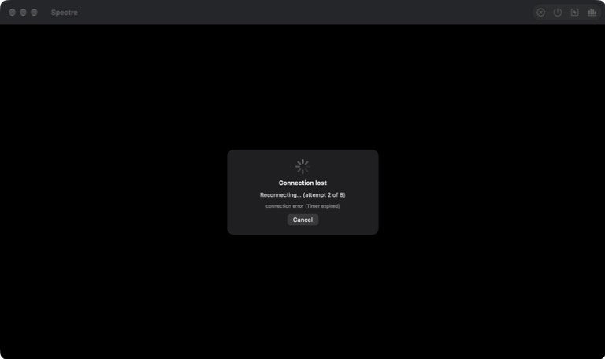

# 断线重连与 iOS 后台

iOS 切到别的 App 再回来、换 Wi-Fi、合盖睡眠之后，会话不再直接结束，而是自动重连。照 `third_party/ghost/docs/spec/gdp-spec.md` §2.1（空闲超时）、§4.6–§4.8（lobby、Redirect、session token）、§6.4（`take_over`）和安全一节的 "Session tokens" 自行实现。



## 两个前提

- **session token 只能用一次**（§4.8，安全一节）：lobby 在 `Redirect` 里给的 token 约 30 秒过期，用过一次就作废。所以断开之后不能拿原来的配置直接重连，必须重新走一遍 lobby 登录。静态 token（§6.11，命令行的 `--connect`）可以重复使用，loopback 的测试 host 也是。
- **断线只能靠空闲超时发现**：libgdp 的 QUIC 空闲超时是 30 秒，而握手完成后它会**忽略 ICMP 错误**（这类错误可以被伪造，用来掐断正在进行的会话，见 `quic_conn.cpp` 的 `socket_error`）。所以网络断掉、对方不再响应时，要等满 30 秒才会报告（客户端开启了 QUIC 保活，但会话连接上本来就一直有 StatsReport 在发，所以这个时间不变，见 [keep-alive.md](keep-alive.md)）。iOS 挂起 App 也是同样的效果：恢复时客户端的计时器立刻到期，host 那边也在 30 秒后让这个 viewer 离开。用户的桌面会话一直在运行，重新登录时 `SessionOpen` 会连回同一个会话（§4.6）。

## 分层

```
App/Shared/ContentView          重连卡片（第几次、最近一次失败的原因、取消）
App/Shared/AppModel             只存内存的登录配方；重放登录拿新 token；需要用户时切回登录页
App/Shared/PlaybackModel        重连循环；iOS 后台：暂停视频、申请后台时间、到期前正常断开
  └ SpectreKit
      ├ ReconnectPolicy         哪些结束要重连、退避节奏、哪些登录失败值得重试、何时自动接管
      ├ LoginFlow.Recipe        录制交互登录的回答和选择；replay 时自动回答，答不了的留给用户
      └ RemoteSession           suspendVideo / resumeVideo；VideoDecoder.reset
  └ GDPKit.GDPSession.Ending    connectionLost：连接失败，而不是有人结束了会话
```

## 什么时候重连

`Ending.connectionLost` 的判断（C++ `SessionClient`）：不是我们自己关闭的、证书没有被拒、没有 §12 关闭码，并且 libgdp 给出了传输层原因（它只在对方用关闭码 0 正常关闭时才不给原因）。也就是空闲超时、连接被重置、拒绝连接、host 不可达都算；host 用任何关闭码关闭（被接管 42、登出 40、在 host 本机登录 41、认证失败 20……），以及我们自己关闭，都不算。

`ReconnectPolicy.reconnects(after:)` 只对"连接丢了"返回真。另外一种情况是 iOS 后台时间用完、由我们自己正常关闭的会话，回到前台时同样重连。

## 重连循环

- **节奏**：最多 8 次，等待 0、1、2、4、8、15、15、15 秒，总共约 1 分钟。回到前台、网络恢复（`NWPathMonitor` 报告可用）时，跳过剩下的等待立即重试。iOS 上只在 App 处于前台时尝试，后台被挂起的尝试只会超时。
- **每次尝试**：先拿一份新配置，再连接，等到 Accept 或结束：
  - 登录会话：`AppModel` 重放登录（见下）。重放失败时，没有响应、host 不可用（§12 的 3x）就下一次再试，密码错误、被拒绝这类就停止，因为再试结果也一样。重放停在需要用户的步骤时，切回登录页。
  - 静态 token、loopback：直接用上一次的配置。
  - 连接结束且仍是"丢了"：继续下一次；其他结束原因：停止，并说明原因。
- **界面**：画面停在最后一帧，上面盖一张卡片，显示"第几次（共 8 次）"和最近一次失败的原因，带取消按钮；工具栏的断开按钮在重连期间也等于取消。成功后卡片消失，会话的其余部分（剪贴板、手柄、软键盘、麦克风开关）按新会话重新建立。
- **放弃**：8 次都失败后，登录会话回到登录页，提示"连接已丢失且无法恢复"。命令行启动的会话（`--connect`、loopback）没有登录页可回，消息只出现在统计浮层和日志里；远端会话的统计默认隐藏，所以看到的是黑屏，取消时也一样。

## 重放登录（只存内存）

- **录制**：交互登录时，`LoginFlow` 按顺序记下每个提问（文字和是否明文显示）和用户的回答、选择的设备、会话类型，组成一份 `Recipe`，打开会话时由 `AppModel` 保存在内存里。会话结束、用户断开或登出、重新登录、退出 App 时都会丢掉，不写磁盘、不进 Keychain。
- **重放**：`LoginFlow.replay(_:allowTakeOver:)` 照常登录，每到一步：
  - 提问：在配方里按顺序找同一个问题（文字和是否明文都相同）的回答，自动回答；找不到（比如这次多了一个一次性验证码）就停在这一步，交给用户回答，之后的步骤照样自动进行。
  - 设备：原来那台还在、并且在线，就自动选它，否则交给用户。
  - 会话：用原来的类型；如果有人在看这个会话（`viewer_attached`），只有允许自动接管时才继续，否则交给用户。
  - 证书需要确认（新服务器、证书变了）：一律交给用户。
- 需要用户时，界面回到登录页，停在那一步，提示"连接已丢失，请重新登录以继续"。用户完成之后，和普通登录一样打开会话。

## 自动接管

客户端自己的连接意外丢掉之后，host 要等它的空闲超时（30 秒）到了才知道这个 viewer 已经走了。在那之前重连，会看到会话"有人在看"（lobby 的 `viewer_attached`，或者 session 的 `ALREADY_CONNECTED`），而这个"人"多半就是刚丢掉的那个连接。所以：

- 丢失后 **1 分钟内**（`ReconnectPolicy.ownViewerWindow`）的重连，允许自动接管（`take_over`）。
- 如果上一个连接是我们自己正常关闭的（iOS 后台时间用完），host 已经知道 viewer 离开了，就不需要接管，也不自动接管。
- 超过 1 分钟后，可能已经有别的设备连了上来，就像普通登录一样问用户。

## iOS 后台

- **进入后台**：暂停视频解码（`RemoteSession.suspendVideo()`：照常确认收到的帧，但直接丢掉，host 不会看到丢包），并用 `beginBackgroundTask` 申请后台时间。后台不允许提交 GPU 任务，硬件解码器也可能被系统作废。声音在后台本来就会停（见 [audio.md](audio.md)），键盘、手柄按"失去焦点"的规则全部松开。
- **很快回来**：连接还在，`resumeVideo()` 重置解码器、请求一个关键帧，并丢掉关键帧之前的帧，画面在一个关键帧之内恢复。
- **后台时间用完**（真机约 30 秒）：在系统挂起 App 之前，正常关闭连接（`closeAndWait`），host 立刻知道 viewer 离开了，桌面会话照常运行；回到前台时重连。
- **被系统直接挂起**（来不及关闭）：恢复时空闲超时到期，按"连接丢了"重连，并允许自动接管。

## 测试

- **GDPKitTests**（新增 4 个测试函数、6 个用例，“Lost connections”）：host 用关闭码 0、40、42 结束都不算丢失；客户端自己关闭不算；没有 host 监听的端口算丢失（握手前的 ICMP 错误立刻生效）；中间的网络断掉（测试里用一个 UDP 中继，`UDPRelay.cut()` 直接关掉它的两个套接字）算丢失，并且要等满 30 秒的空闲超时，这个测试因此要跑 30 秒。
- **SpectreKitTests**（新增 11 个测试函数）：
  - 登录重放：交互登录被录制、重放时不需要用户；配方里没有的提问停下来交给用户，答完后继续自动；记下的密码不再有效时失败（20）并结束重放；有人在看的会话只在允许时接管；记下的设备还在就自动选、不在就交给用户；取消会停止重放。
  - `ReconnectPolicy`：只有连接丢失才重连；哪些登录失败值得重试；只在丢失后 1 分钟内自动接管；退避总时长约 1 分钟。
  - 端到端：暂停视频期间 host 照常发送，但客户端不解码，也不报告丢包；恢复后客户端请求关键帧，从关键帧开始解码，没有解码错误。

## 实测

**iPad 模拟器（iPad Pro 13-inch (M5)，iOS 27.0），demo（lobby 登录）**：

- 回到主屏幕约 10 秒再回来：日志 `in the background, video paused` → `back in front, video resumed`，连接没有断，画面恢复到 60 fps，没有丢帧。
- 回到主屏幕 4 分钟：**模拟器里后台时间一直没有到期**，App 在后台一直运行（视频照收约 30 Mb/s，显示 0 fps），过期处理没有触发。所以“后台时间用完 → 正常断开 → 回来重连”这条路径要在真机上验证。
- 用 `kill -STOP` 把 App 进程整个冻住 40 秒，再 `kill -CONT`（和 iOS 挂起一样，进程什么都不做；demo 服务器在同一个进程里，也一起冻住）：恢复后立刻 `ended: connection error (Timer expired)`，第 1 次重连自动重放了 lobby 登录（密码来自内存里的配方），会话重新建立，用户什么都不用做。重复两次结果相同。
- 发现并修好的问题：每次 Accept 都会把编码信息再追加到标题后面，重连之后标题变成 “… — h264 1920×1080, test — h264 1920×1080, test”。

**macOS，静态 token**：用一个独立的小程序跑测试 host（只在 scratchpad 里，依赖 GDPKit），App 用 `--connect` 连上，然后 `kill -STOP` 冻住 host：

- 30 秒后 `Timer expired`，第 1、2 次尝试因为 host 不响应（`timed out (no response from host)`）失败，卡片显示 “Connection lost / Reconnecting… (attempt 2 of 8)”（见上图）。
- 让 host 恢复：1 秒内第 3 次尝试连上，host 记录到 `take_over` 为真，也就是丢失 1 分钟内的自动接管生效了。
- 再次冻住 host、出现卡片后点 Cancel：卡片消失，之后不再尝试。

**没有验证的**：真机上后台时间用完的路径；真实 wraith 和 ghostd lobby 上的重放（包括多步认证）；换网络（Wi-Fi 换蜂窝）时的恢复速度。

## 没有做的

- 配方本身只在内存里。勾选了 Remember 的登录另外存在 Keychain 里，App 重新打开后可以一键登录，见 [saved-logins.md](saved-logins.md)。
- QUIC 连接迁移（换网络时保持同一个连接）：libgdp 没有提供。
- 后台音频模式：后台继续播放声音、保持连接更久，是另一个产品决定（见 [audio.md](audio.md)）。
