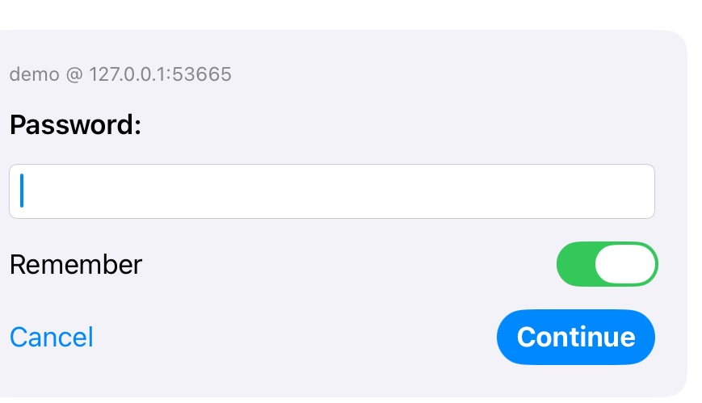

# 保存密码（Keychain）

> 2026-10-16 起登录页和它的最近列表没有了（iPad、iPhone、Mac 都换成了主机首页，见 [ipad-layout.md](ipad-layout.md)、[macos-layout.md](macos-layout.md)）：有保存密码的主机，点“Connect”直接用钥匙串里的回答登录；详情页的“More › Forget Password”忘记密码。下文说的“最近列表”是当时的界面，保存和重放的机制没有变。

登录时勾选“Remember”，下次在最近列表里点一下就直接登录，不再输入密码。登录回答存在系统 Keychain 里，只在这台设备上，不同步。协议本身不涉及：lobby 的提问（§4.3）照常一问一答，客户端只是替用户把记下的回答再答一遍，用的是断线重连那套重放（见 [reconnect.md](reconnect.md)）。



## 分层

```
App/Shared/LoginView            表单密码框下和密码提问下的 Remember 开关；最近列表的钥匙图标、点一下直接登录、长按菜单
App/Shared/AppModel             哪些最近登录有保存的密码；signInWithSaved；忘记密码
  └ SpectreKit/Login
      ├ LoginFlow               登录成功（Redirect）时保存或删除；signInWithSaved 重放；密码失效时删除并改为交互登录
      ├ LoginFlow.Recipe        每个回答多记一个 remember；toSave 只取勾选的密码和明文回答
      └ SavedLogins             协议；KeychainSavedLogins（真用）、MemorySavedLogins（测试）
```

## 存什么

- **一条记录对应一个用户名 + 服务器**：Keychain 的通用密码，service 是 `org.ghost.spectre.apple.login`，account 是 `用户名@主机:端口`，内容是一段 JSON（`SavedLogin`）：
  - 回答列表：每个提问的文字、是否明文、回答。**密码类提问（`echo` 为假）只存勾选了 Remember 的**；明文提问（比如用户名、选项）的回答也存，重放时才能按顺序答上。
  - 选择的设备 ID 和会话类型（桌面环境）。
- **不勾选就不存**：一个密码都没勾，`Recipe.toSave` 为空，什么也不写。一次性验证码这类提问不要勾，下次登录时它不在记录里，就会停下来问用户，其余步骤照样自动。
- **什么时候写**：服务器接受登录、发出 `Redirect` 之后才写。密码错了不会被存下来。
- **什么时候删**：
  - 这次登录答了密码、但没有勾 Remember：删掉旧的记录（用户改了主意）。
  - 用保存的密码登录，服务器回 `AUTH_FAILED`（20）：删掉记录，提示 “The saved password no longer works. Sign in again.”，接着按普通交互登录从头问一遍。
  - 用户在最近列表里长按选 “Forget Saved Password”，或者删掉这条最近登录（× 或 “Forget This Login”）。

## 平台差异

- **iOS**：`kSecAttrAccessibleAfterFirstUnlockThisDeviceOnly`，开机后解锁过一次就能读，不进 iCloud 钥匙串、不进备份迁移。
- **macOS**：存在登录钥匙串（传统的文件钥匙串）里。数据保护钥匙串需要有开发团队签名的 App，现在的 ad-hoc 签名用不了。登录钥匙串按代码签名决定谁能读，所以**每次重新编译（签名变了）之后第一次读密码，系统会问是否允许**，选“始终允许”即可；“只看有没有保存”（`contains`，只取属性不取数据）不会触发这个询问，所以打开登录页、显示钥匙图标时不会弹窗，只有真的点了才会。
- 系统的“密码”自动填充照常可用：密码框本来就设置了 `textContentType(.password)`，iPad 键盘上方会出现 Passwords 按钮。两者互不影响。

## 界面

- **Remember 开关**：在登录表单的密码框下面（密码为空时不可用），也在之后的密码类提问下面。默认关；如果这个账号已经保存过，默认开（保持原状，不勾就是删除）。表单的密码答的是第一个密码类提问，所以存下来的和在提问页上勾选的一样。
- **最近列表**：有保存密码的条目显示钥匙图标，点一下直接登录（证书已信任、设备还在、会话没人在看时，全程不需要用户）。其他条目照旧只是填入服务器和用户名。
- **需要用户的情况**和断线重连的重放一样：证书需要确认、记录里没有的提问、设备不在了、会话有人在看（这里**不会**自动接管），都停在那一步交给用户。
- **长按菜单**（macOS 上是右键）：“Forget Saved Password”（有保存时）和 “Forget This Login”。

## 测试

- **SpectreKitTests**（新增 7 个）：
  - `SavedLogins`：真实 Keychain 的写入、读出、覆盖、删除，按用户名和端口区分、主机名不区分大小写（用一个专门的 service，测完删掉）；内存版本行为一致。iOS 模拟器上的包测试没有 Keychain entitlement（`errSecMissingEntitlement`，-34018），这个测试自动跳过，macOS 上照常运行。
  - 登录流程：勾选的密码在登录成功后才保存；不勾选会删掉已有的记录；一键登录重放保存的回答，不需要用户；一次性验证码每次都问、从不保存；保存的密码失效时删掉记录、显示提示、改为交互登录。

## 实测

**iPad 模拟器（iPad Pro 13-inch (M5)，iOS 27.0），demo（lobby 登录）**：

- 密码提问下出现 Remember，默认关。打开、输入 demo、选桌面后进入会话，日志里有 `SecItemDelete`、`SecItemAdd`。
- 断开后，最近列表里这一条变成钥匙图标；点它直接进入会话，没有任何提问。
- 退出 App 重新打开，钥匙图标还在（Keychain 里的记录保留下来）。
- 长按选 “Forget Saved Password”，图标变回时钟。
- 顺带发现：lobby 提问停留超过约 30 秒，连接会因 QUIC 空闲超时断开（`Timer expired`），因为客户端没有打开 keep-alive。这跟保存密码无关，另作一项处理。

**没有验证的**：macOS App 里重新编译后的钥匙串授权弹窗（单元测试已在 macOS 的真实 Keychain 上通过）；真机；真实 ghostd 上的多步认证。

## 没有做的

- 生物识别（Face ID / Touch ID）解锁：按决定先不做。以后可以给 Keychain 条目加 `SecAccessControl`（`.userPresence`）。
- 存进系统“密码”App：需要 associated domains，按 IP 和端口连接的 host 没有对应的网站。
- 管理所有已保存密码的界面：现在只能在最近列表里逐条忘记；最近列表删掉一条时，它的密码也一起删掉。
