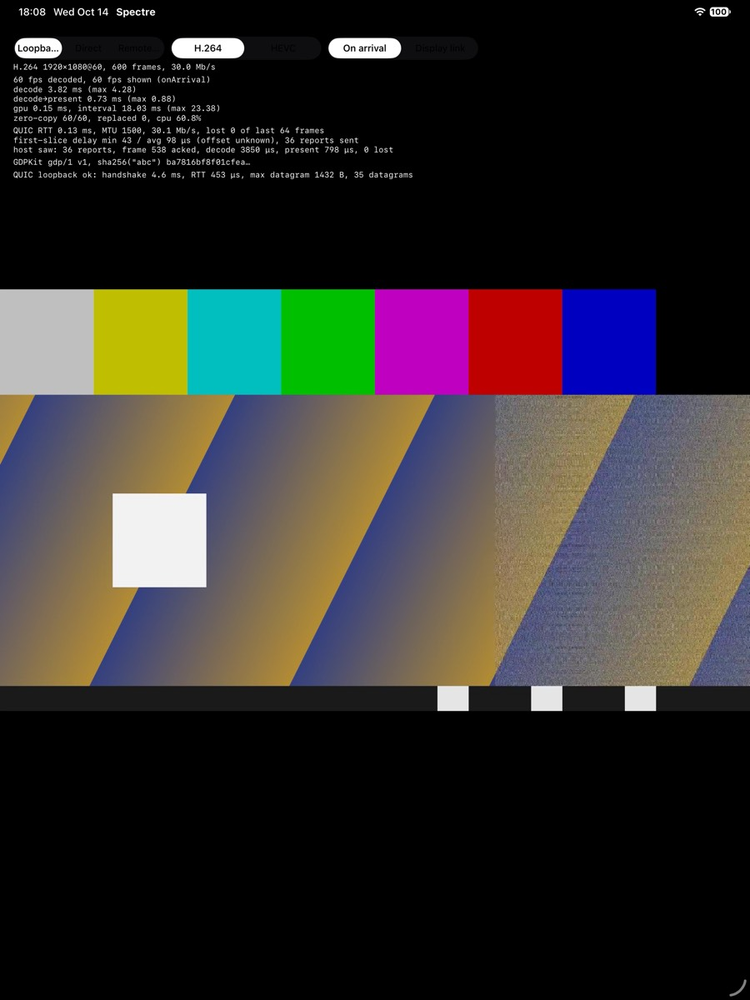

# 会话层（SessionClient）

照 `third_party/ghost/docs/spec/gdp-spec.md` §6–§11 和 MIT 的 `libgdp/proto/session.proto` 自行实现。没有参考上游 `client/spectre/src/net/session_client.*`（GPL-3.0）。



## 分层

```
App/Shared/PlaybackModel          来源：loopback（默认）/ direct / remote
  └ SpectreKit.RemoteSession      帧 → VideoDecoder（解码队列）→ FrameMailbox → VideoPresenter；耗时回填 StatsReport
      └ GDPKit.GDPSession         Swift：串行队列、notify_fd 读源、250 ms 定时器、命令切队列
          └ gdpcore.h (C ABI)     gdpc_session_*
              └ gdpcore::SessionClient (C++)   继承 libgdp 的 gdp::ClientConnection
                  └ StreamReceiveStats         ack/丢失窗口、单程延迟、帧串、字节、耗时
```

代码位置：

- C++：`Packages/GDPKit/Native/src/session_client.*`、`receive_stats.*`、`session_api.cpp`
- 测试 host：`test_host.*`
- Swift：`Packages/GDPKit/Sources/GDPKit/GDPSession.swift`、`GDPTestHost.swift`、`Packages/SpectreKit/Sources/SpectreKit/Session/RemoteSession.swift`、`TestSource/LoopbackHost.swift`

**线程**：C++ 部分是单线程的，不加锁。`GDPSession` 拥有一个串行队列：`DispatchSourceRead` 监听 libgdp 的 `notify_fd()`，一有事件就调 `dispatch()`；另有一个 250 ms 的定时器，先 `dispatch()` 再发 StatsReport。所有回调都在这个队列上触发，命令（输入、请求关键帧等）可以从任何线程调用，会被切到这个队列执行。视频帧在回调里拷贝一次（只拷压缩码流），交给独立的解码队列，不阻塞网络队列。到达时间用的是 libgdp 网络线程读到 datagram 的时间（`arrival_us`），所以在队列上的排队不影响延迟统计。

## 对照规范

| 规范 | 实现 |
|---|---|
| §2.3 证书固定 | `cert_sha256` 必须是 64 位小写十六进制，否则连接直接失败；握手后比对证书指纹，不一致就在发出任何字节（包括 token）之前关闭，`closed` 回调里 `certificate_rejected = true` |
| §2.2 两个流 | 握手后先开 control 流，再开 input 流 |
| §6.2 SessionHello | token、take_over、via_gateway（总是 false）、network_profile、displays（0×0 时不带）、codecs、capabilities、decoders。颜色相关的声明（codec_formats、primaries、transfers）不发，也就是只要求基线（8 bit 4:2:0、BT.709、sRGB） |
| §6.5 Accept / Reject | 收到 Accept 才算建立，此时把会话时钟清零（§11）。收到 Reject：记录原因，以 code 0 关闭，结束原因里带上 reason |
| §6.6 codec | Accept 的 codec 不在提供的列表里：以 `NO_COMMON_CODEC`(13) 关闭，不建立会话 |
| §6.7 capability | Accept 里的 capability 只保留我们提供过的，并去重 |
| §7.1 消息有效性 | 建立之前只处理 Accept/Reject；第二个 Accept、方向不对的消息、未知消息一律忽略 |
| §7.2 DisplaysChanged | 交给上层；`RemoteSession` 据此更新画面尺寸和色彩描述 |
| §7.3 色彩 | `OutputDescriptor.color` 中未指定的字段取 codec 默认值（h264/h265 是 BT.601 limited） |
| §7.4 光标 | 边长超过 384，或字节数不等于 宽×高×4 的形状直接忽略；0×0 表示"不显示光标" |
| §7.5 StatsReport | 每 250 ms 一次，字段全部实现（见下） |
| §7.6 KeyframeRequest | 需要关键帧时发出，同一个流每秒最多一次 |
| §7.7 Ping/Pong | 建立后收到 Ping 立即回 Pong（nonce 相同） |
| §6.10 GatewayPath | 记下上游 RTT，加到 StatsReport 的 `rtt_us` 和统计显示里 |
| §7.10 Logout | 发 LogoutRequest；以 host 关闭时的 `SESSION_ENDED`(40) 作为完成信号 |
| §7.11 诊断 | 收到请求后回调上层；每个请求只回答一次，超过 512 KiB 的部分截掉 |
| §8 输入 | 键盘（HID usage）、指针移动（绝对/相对）、按键（`BTN_*`）、滚轮（以 notch 为单位）、触摸。建立之前不发；`client_time_us` 取单调时钟 |
| §8.4 input 流上的回程数据 | 没有 `hid` capability 时，host 发来的数据一律忽略 |
| §3.2 datagram | 只处理视频（0x01）和音频（0x02），其它通道丢弃；音频在建立之后原样交给上层 |
| §9.3 重组 | 用 libgdp 的 `VideoFrameReassembler`。丢包后丢弃非关键帧，直到下一个关键帧（可配置） |
| §11 32 位回绕 | frame_id 和 pts 只按差值比较（转成 int32）；测试覆盖了从 0xFFFFFFFE 回绕到 1 的情况 |
| §12 关闭码 | 协议错误时用对应的码关闭（11/12/13）；host 关闭时把码和 libgdp 的描述交给上层；`Ending.isOrdinaryEnd` 按"十位数分组"判断 |

### StatsReport 的各字段

- **`rtt_us`**：ngtcp2 的平滑 RTT 加上 GatewayPath 的上游 RTT。
- **ack 和丢失**：`highest_frame_id_acked` 是完整收到的最大 frame_id。`loss_bitmap` 的第 i 位表示 `highest − i` 这一帧丢了。以下几种都算丢失：从没拼完整的帧、拼完整但在等关键帧期间被丢弃的帧、解码器拒绝的帧（`markFrameDiscarded`）。窗口从第一个**有分片到达**的帧开始算（不是第一个拼完整的帧），这样首个关键帧不完整时，也能把它报成丢失，让 host 补发。
- **`decode_us` / `present_us`**：最近一帧上屏时的解码耗时和"解码完成到上屏"耗时，由 `PlaybackStats` 的回调提供。
- **`interval_us`、`bytes_received`**：本窗口的时长和收到的视频 datagram 字节数（含通道字节和头）。窗口长度不会报 0（规范规定，只有不测量这些字段的客户端才报 0）。
- **延迟**：对窗口内每一帧**最先到达**的那个分片，计算"到达时刻（按会话时钟）− pts"，统计最小值、平均值和样本数。同一帧的后续分片、比当前帧更旧的迟到分片都不计入。
- **帧串**：只有满足三个条件的帧才报：本窗口内完成、每个分片恰好到达一次、分片数至少 16。每份报告最多 8 条，超过时保留最新的。`bytes` 是第一个之后所有 datagram 的字节数，`span_us` 是第一个到最后一个的到达时间差。

### 其他取舍

- **datagram 先于 Accept 到达**：QUIC 里流数据可能因为重传落在 datagram 后面。这种情况下照常重组，拼好的帧先缓存（最多 8 帧），收到 Accept 后再按顺序交出去。
- **开局就要关键帧**：每个流一开始就处于"等关键帧"状态。如果第一个拼完整的帧不是关键帧，会丢弃它并请求关键帧。
- **Reject**：规范允许 host 先发 Reject 再用 §12 的码关闭。客户端收到 Reject 立即以 0 关闭，以免等不到 host 的关闭；reason 会保留在结束原因里。
- **销毁**：`GDPSession` 被释放时会直接销毁连接，不发 CONNECTION_CLOSE。正常断开要先调 `close()`。（第一次写测试时，因为 `_ = try await connected(...)` 让会话立即被释放，就踩到了这一点。）

## 没有实现的

- capability：`clipboard`、`refine`、`gamepad`、`hid`、`microphone`。实现之前不会在 SessionHello 里提供，所以 host 也不会启用它们。
- 额外的流（§2.2 的 `StreamOpen`）：客户端不授予额外流的额度，收到也不会处理。
- AV1、PyroWave（VideoToolbox 解不了 PyroWave；AV1 要看硬件，以后再评估）。
- ~~lobby 阶段（`LobbyClient`、§4）~~：已完成，见 [login.md](login.md)。

## 测试 host

`gdpcore::TestHost` 是照规范写的最小会话 host，在自己的线程里驱动 libgdp 的 `Transport`。它在 127.0.0.1 上监听，用现场生成的证书和静态 token：

- 校验 SessionHello：认证前单帧上限 16 KiB，第一帧必须是 SessionHello，否则以 `AUTH_FAILED` 关闭；token 不对也是 `AUTH_FAILED`；同一时间只允许一个 viewer，另一个连接要 take_over 才能顶替。
- 按客户端的偏好选择 codec，capability 取双方的交集；发送 Accept 和光标；按 §7.2 的规则响应 ResolutionChange；收到 Logout 后以 `SESSION_ENDED` 关闭。
- 把视频帧切成 datagram 发送（可以指定丢弃某些分片，模拟丢包），也能发送音频、Ping、光标、DisplaysChanged、网络 profile、GatewayPath、诊断请求。
- 可以故意出错：选一个客户端没提供的 codec、用指定的码拒绝、发 Reject、在 Accept 之前发 Ping、让 frame_id 从任意值开始。
- 记录收到的一切，包括每份 StatsReport 的字段和所有被报告为丢失的 frame_id。收到 KeyframeRequest 或有新的丢失时会标记"需要关键帧"。

App 的 loopback 模式（`SpectreKit.LoopbackHost`）就是用它按 60 Hz 播放测试码流，收到"需要关键帧"时从第 0 帧（IDR）重新开始。

## 测试（GDPKitTests 新增 19 个，SpectreKitTests 新增 1 个）

- **建立会话**：SessionHello 的各字段和协商结果；证书不符时 host 收不到 hello；token 错误（20）；host 的拒绝码（24，以及属于 4x 正常结束的 41）；host 选了没提供的 codec（13）；Reject 的原因；Accept 之前的 Ping 被忽略、之后的 Ping 有回应；配置错误；Accept 之前的输入不会发出。
- **视频和统计**：30 帧内容完整、顺序和标志正确；StatsReport 的 ack、耗时、窗口长度、字节数、RTT；帧串的分片数和字节数精确到字节；丢一个分片后，丢失的帧（2、3、4）和等关键帧期间被丢弃的帧数都对；解码器拒绝的帧算丢失并请求关键帧；frame_id 回绕。
- **控制和输入**：光标（正常、长度不对、隐藏）、光标位置、网络 profile、DisplaysChanged、GatewayPath 加进 RTT；诊断只回答一次且截断到 512 KiB；关键帧请求、分辨率请求（合法和奇数尺寸）、键盘、指针、按键、滚轮、触摸、Logout 后以 40 结束；音频包；host 主动关闭（42）。
- **端到端（SpectreKit）**：H.264 和 HEVC 测试码流经 LoopbackHost → QUIC → GDPSession → RemoteSession → VideoDecoder，帧按顺序没有缺失，host 收到的 StatsReport 里有真实的解码和显示耗时，没有丢失。

macOS 上 GDPKit 的 37 个测试每次约 0.3 秒，连跑 5 遍全部通过；iPad 模拟器上 37 + 9 个测试也全部通过。

## 测量（macOS，Release，本机回环，1080p60，约 30 Mb/s）

| | H.264 | HEVC |
|---|---|---|
| 解码 / 上屏 | 1829 / 1828 帧（60 fps） | 1820 / 1820 帧（60 fps） |
| 丢失 | 0 | 0 |
| 解码 p50 | 1.59 ms | 1.06 ms |
| QUIC RTT / 路径 MTU | 0.09 ms / 1500 | 0.08 ms / 1500 |
| StatsReport | 30 秒 129 份，host 全部收到 | 129 份 |
| 进程 CPU（包含测试 host 的发送） | 10.9% | 11.1% |

这一轮的解码到上屏耗时不能和原型阶段比较：窗口开在了 60 Hz 的副屏上（见下）。

### 发现：60 Hz 屏幕上的呈现延迟

原型阶段的测量窗口在 120 Hz 主屏上（解码到上屏 p50 约 13 ms）。这次窗口落在了 60 Hz 的副屏上，延迟变成 54–64 ms。原因是：内容帧率和刷新率一样都是 60 时，"到了就画"会让 CAMetalLayer 的 3 个 drawable 排满，而到达速率等于消耗速率，积压就再也消化不掉。

`VideoPresenter.maxFramesInFlight` 用来限制已提交但还没上屏的 drawable 数量。超过上限时，新帧留在邮箱里，只保留最新的一帧，等某个 drawable 上屏后再画。

| 屏幕 | 上限 | 上屏帧率 | 解码到上屏 p50 |
|---|---|---|---|
| 60 Hz（C15U1） | 不限 | 60 fps | 54.5–64.2 ms |
| 60 Hz | 1 | **30 fps** | 41.2–43.3 ms |
| 60 Hz | 2 | 60 fps | **32.1–33.6 ms** |
| 120 Hz（DELL U2725QE） | 不限 | 60 fps | 13.7 ms |
| 120 Hz | 2 | 60 fps | 12.4 ms |

默认值定为 2。上限设为 1 会让帧率减半：drawable 的 presented 回调要等它真正上屏后才触发，这时再画下一帧已经赶不上下一次合成。在 macOS 的窗口模式下，WindowServer 合成要占约 1 帧，所以 60 Hz 上 2 帧左右的延迟大概就是下限。全屏时能不能绕过合成，以后再测。原始数据在 `build/logs/bench-inflight.txt`；bench 时可以用 `--screen N` 选屏幕，用 `--in-flight N` 设上限。

## 连接真实的 wraith

wraith 可以用静态 token 直接监听（§6.11），不需要 ghostd：

```bash
wraith -l 9000 -t TOKEN -c cert.pem -k key.pem -p TYPE
```

取证书指纹：

```bash
openssl x509 -in cert.pem -noout -fingerprint -sha256 | cut -d= -f2 | tr -d : | tr A-F a-f
```

然后启动 App（macOS）：

```bash
build/DerivedData/Build/Products/Release/Spectre.app/Contents/MacOS/Spectre --connect HOST:9000 --token TOKEN --fingerprint SHA256
```

还没有在真实的 wraith 上测过，这是下一步要做的。
